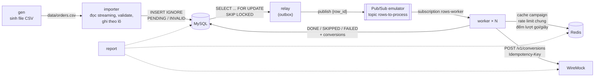

# conversion-pipeline

Pipeline xử lý file CSV lớn chứa đơn hàng offline và gửi từng đơn hợp lệ tới API của một nền tảng quảng cáo (giả lập bằng WireMock). Viết bằng Go, chạy bằng Docker Compose.

Hệ thống chịu được chạy lại, bị dừng giữa chừng và nhiều instance cùng chạy mà **không mất đơn và không ghi nhận trùng**. Chi tiết yêu cầu ở `docs/01`, lý do thiết kế ở `docs/02`, câu chuyện 11 sự cố production ở `docs/04`.

## Kiến trúc



| Chương trình | Việc | Điểm chính |
| --- | --- | --- |
| `cmd/gen` | Sinh file CSV mẫu với các tình huống lỗi theo tỉ lệ | Cùng `-seed` thì cùng file |
| `cmd/importer` | Đọc file, validate, ghi `import_rows` | Pipeline 1 reader → N parser → 1 writer; SHA-256 chống nạp lại; Ctrl+C ghi nốt lô rồi thoát |
| `cmd/relay` | Đọc dòng `PENDING`, publish lên Pub/Sub | Outbox pattern; `SKIP LOCKED` cho nhiều relay; đóng job khi xong |
| `cmd/worker` | Gửi từng dòng tới API | Idempotent 3 lớp; phân loại lỗi; retry có backoff; cache và rate limit trên Redis |
| `cmd/report` | In báo cáo một job | Tự kiểm `done + skipped + failed + invalid = total` |

## Chạy demo (docs/01 mục 10.1)

Chỉ cần Go và Docker (Compose v2).

```bash
# 1. Sinh dữ liệu
go run ./cmd/gen -rows 20000 -out data/orders.csv -seed 42

# 2. Build và khởi động hạ tầng + relay + 1 worker, chờ healthcheck đạt
docker compose up -d --build --wait

# 3. Nạp file
docker compose run --rm importer -file /data/orders.csv

# 4. Scale lên 3 worker
docker compose up -d --scale worker=3 --no-recreate

# 5. Chờ job xong rồi in báo cáo
docker compose run --rm report -wait

# 6. Dọn dẹp (xoá cả dữ liệu MySQL)
docker compose down -v
```

> **Lưu ý:** nếu shell đang `export` các biến cho `go run` (ví dụ `MYSQL_DSN=...localhost...`), Compose sẽ dùng luôn giá trị đó cho container và container không kết nối được. Mở shell mới hoặc `unset` các biến đó trước khi chạy Docker.

### Kết quả một lần chạy

```
Job 1  file=/data/orders.csv  status=DONE  duration=1m38s
  total    20000
  done     15583
  skipped  181
  failed   3800   (campaign_not_found=1776, campaign_paused=1810, click_expired=179, max_attempts=35)
  invalid  436
  check    done + skipped + failed + invalid = total  -> OK
Redis cache    hits=19461  misses=243
API calls/sec  peak=201  limit=200  (from calls:* in Redis, last hour)
WireMock       POST /v1/conversions received=16118
Conversions    rows for this job = 15583   (must equal done = 15583) -> OK
```

### Vì sao WireMock nhận nhiều request hơn số dòng `DONE`

16.118 request nhưng chỉ 15.583 dòng `DONE`. Phần chênh lệch là các lần gọi **đúng** nhưng không tạo ra conversion mới:

| Nguồn | Số request | Vì sao |
| --- | --- | --- |
| Dòng `DONE` | 15.583 | Mỗi dòng một lần gọi thành công |
| Dòng `SKIPPED` (trùng `order_id`) | 181 | API trả 200, nhưng khoá chính `order_id` của bảng `conversions` chặn ghi nhận lần hai |
| `click_expired` | 179 | API trả 400, dòng `FAILED`, không thử lại |
| `max_attempts` | 35 × 5 = 175 | API luôn trả 500 với `clk_err`, worker thử đủ `MAX_ATTEMPTS` lần |
| **Tổng** | **16.118** | |

Dòng `INVALID` (sai định dạng) và dòng có campaign không tồn tại hoặc `PAUSED` **không** gọi API, nên không có trong con số này.

## Lệnh thường dùng (docs/01 mục 10.2)

| Việc | Lệnh |
| --- | --- |
| Chạy unit test | `go test -race ./...` |
| Kiểm tra code | `go vet ./...` |
| Build toàn bộ trên máy | `go build ./...` |
| Xem log worker | `docker compose logs -f worker` |
| Xem log relay | `docker compose logs -f relay` |
| Trạng thái các service | `docker compose ps` |
| Vào MySQL | `docker compose exec mysql mysql -uapp -papp pipeline` |
| Vào Redis | `docker compose exec redis redis-cli` |
| Build lại sau khi sửa code | `docker compose up -d --build` |
| Tắt rate limiter để so sánh | `RATE_LIMIT_ENABLED=false docker compose up -d --scale worker=3` |
| Báo cáo một job cụ thể | `docker compose run --rm report -job 1` |

### Chạy bằng `go run` khi phát triển

Hạ tầng chạy trong Docker, chương trình Go chạy trực tiếp trên máy:

```bash
docker compose up -d --wait mysql redis pubsub wiremock
export MYSQL_DSN='app:app@tcp(localhost:3306)/pipeline?parseTime=true'
export REDIS_ADDR=localhost:6379 PUBSUB_EMULATOR_HOST=localhost:8085 PLATFORM_URL=http://localhost:8080
go run ./cmd/importer -file data/orders.csv
go run ./cmd/relay
go run ./cmd/worker
go run ./cmd/report -wait
```

### Test tích hợp

Unit test chạy không cần hạ tầng. Test chạm MySQL hoặc Redis tự `t.Skip` khi thiếu biến môi trường:

```bash
# Database riêng cho test, để test không đụng dữ liệu thật (tạo lại sau mỗi lần down -v)
docker compose exec -T mysql mysql -uroot -proot -e "CREATE DATABASE pipeline_test; GRANT ALL ON pipeline_test.* TO 'app'@'%';"
docker compose exec -T mysql mysql -uroot -proot pipeline_test < migrations/01_schema.sql
docker compose exec -T mysql mysql -uroot -proot pipeline_test < migrations/02_seed.sql

MYSQL_DSN='app:app@tcp(localhost:3306)/pipeline_test?parseTime=true' REDIS_ADDR=localhost:6379 go test -race ./...
```

Test Redis dùng DB số 15, không đụng key của worker ở DB 0.

## Cấu hình

Mọi cấu hình đọc từ biến môi trường trong `internal/config`, kiểm tra ngay lúc khởi động. Giá trị sai thì chương trình dừng với thông báo rõ ràng.

### Ghi đè trên máy của bạn: `.env`

```bash
cp .env.example .env   # rồi bỏ comment và sửa dòng cần đổi
```

- Docker Compose tự đọc `.env` ở thư mục gốc. Dòng nào không có trong `.env` thì dùng mặc định ở bảng dưới.
- `.env` **không được commit** (đã có trong `.gitignore`) và không bị đưa vào image (đã có trong `.dockerignore`). `.env.example` được commit để làm tài liệu, không chứa bí mật.
- Hay dùng nhất là đổi cổng phía host khi máy đang có chương trình khác chiếm cổng: `MYSQL_HOST_PORT`, `REDIS_HOST_PORT`, `PUBSUB_HOST_PORT`, `WIREMOCK_HOST_PORT`. Đổi cổng thì nhớ đổi theo các biến `localhost` khi chạy `go run`.
- Thứ tự ưu tiên: biến `export` trong shell > `.env` > mặc định trong `compose.yaml`.
- Chương trình chạy bằng `go run` **không** đọc `.env`, chỉ thấy biến đã `export` trong shell.
- `.env` chỉ giúp không commit cấu hình riêng của từng máy, nó **không mã hoá** gì cả. Mật khẩu MySQL trong `compose.yaml` là mật khẩu demo local. Production lấy bí mật từ Secret Manager (`docs/02` mục 18).

| Biến | Mặc định | Dùng bởi | Ý nghĩa |
| --- | --- | --- | --- |
| `MYSQL_DSN` | `app:app@tcp(mysql:3306)/pipeline?parseTime=true` | tất cả | Kết nối MySQL. `parseTime=true` để đọc `DATETIME` thành `time.Time` |
| `MYSQL_MAX_OPEN_CONNS` | `10` | tất cả | Số connection tối đa mỗi tiến trình. Tổng các instance phải nhỏ hơn `max_connections` của MySQL |
| `REDIS_ADDR` | `redis:6379` | worker, report | Địa chỉ Redis |
| `PUBSUB_EMULATOR_HOST` | `pubsub:8085` | relay, worker | Địa chỉ Pub/Sub emulator |
| `PUBSUB_PROJECT_ID` | `demo` | relay, worker | Project của emulator |
| `PUBSUB_TOPIC` | `rows-to-process` | relay, worker | Topic chứa `{row_id}` |
| `PUBSUB_SUBSCRIPTION` | `rows-worker` | relay, worker | Subscription mọi worker cùng nghe |
| `IMPORT_BATCH_SIZE` | `500` | importer | Số dòng mỗi câu `INSERT IGNORE`, tối đa 6553 (giới hạn 65.535 placeholder) |
| `IMPORT_PARSERS` | `4` | importer | Số goroutine parse song song |
| `RELAY_BATCH_SIZE` | `500` | relay | Số dòng lấy mỗi vòng |
| `RELAY_INTERVAL` | `1s` | relay | Khoảng cách giữa các vòng |
| `PLATFORM_URL` | `http://wiremock:8080` | worker, report | Gốc URL của API |
| `RATE_LIMIT_ENABLED` | `true` | worker | Tắt để so sánh (AC-7) |
| `RATE_LIMIT_RPS` | `200` | worker, report | Số lượt gọi API mỗi giây cho **cả hệ thống** |
| `CACHE_TTL` | `10m` | worker | Thời gian sống của cache campaign (±10% jitter) |
| `WORKER_MAX_OUTSTANDING` | `100` | worker | Số message xử lý đồng thời mỗi instance |
| `MAX_ATTEMPTS` | `5` | worker | Số lần thử tối đa với lỗi tạm thời |

## Kiểm tra các tiêu chí nghiệm thu (docs/01 mục 11)

| AC | Cách chạy | Kết quả mong đợi |
| --- | --- | --- |
| AC-1 | Kịch bản ở mục "Chạy demo" | Chạy hết không lỗi, in báo cáo |
| AC-2 | Xem báo cáo | Hai dòng `check` và `Conversions` đều `OK` |
| AC-3 | Chạy lại `docker compose run --rm importer -file /data/orders.csv` | `file already imported, nothing to do`, không thêm dòng |
| AC-4 | Ctrl+C khi importer đang chạy (nên dùng file lớn, ví dụ `-rows 1000000`), rồi chạy lại | Log báo job vẫn `IMPORTING`; lần sau tiếp tục, `total_rows` đúng, không trùng `(job_id, line_no)` |
| AC-5 | Trong lúc xử lý: `docker compose kill worker` rồi `docker compose up -d --scale worker=3` | Job vẫn `DONE`, conversion bằng số `DONE`, không `order_id` nào ghi hai lần |
| AC-6 | 3 worker, rate limit bật | `peak` ≤ 220 |
| AC-7 | `docker compose down -v`, chạy lại với `RATE_LIMIT_ENABLED=false` và 3 worker | `peak` vượt 200 rõ rệt (khoảng 1.100 khi đo) |
| AC-8 | Xem dòng `Redis cache` | `misses` xấp xỉ số campaign khác nhau (khoảng 220); cao hơn một chút vì nhiều handler cùng miss một campaign lúc đầu |
| AC-9 | `SELECT attempts, error FROM import_rows WHERE click_id LIKE 'clk_err%'` | `attempts = 5`, `error = max_attempts`; log worker có `backoff` 1s, 2s, 4s, 8s |
| AC-10 | `SELECT status, error FROM import_rows WHERE status IN ('INVALID','FAILED')` | Mọi dòng đều có `error` |
| AC-11 | `go run ./cmd/gen -rows 1000000 ...` rồi import, xem `docker stats` | Bộ nhớ importer không tăng theo kích thước file (khoảng 17 MB khi đo) |
| AC-12 | `go test -race ./...` | Pass |

## Ghi chú

- `gen` luôn đặt `order_id` là `A000001`, `A000002`... Hai file sinh với seed khác nhau vì thế **trùng `order_id`**. Nạp file thứ hai sau file thứ nhất sẽ có rất nhiều `SKIPPED`. Đó là cơ chế chống ghi nhận trùng hoạt động đúng, không phải lỗi.
- Pub/Sub emulator chỉ lưu trong bộ nhớ. Container `pubsub` khởi động lại thì mất message: các dòng `PUBLISHED` sẽ kẹt lại. Khi đó chạy lại từ đầu bằng `docker compose down -v`.
- Những gì demo cố ý bỏ qua so với production: xem `docs/02` mục 18.
