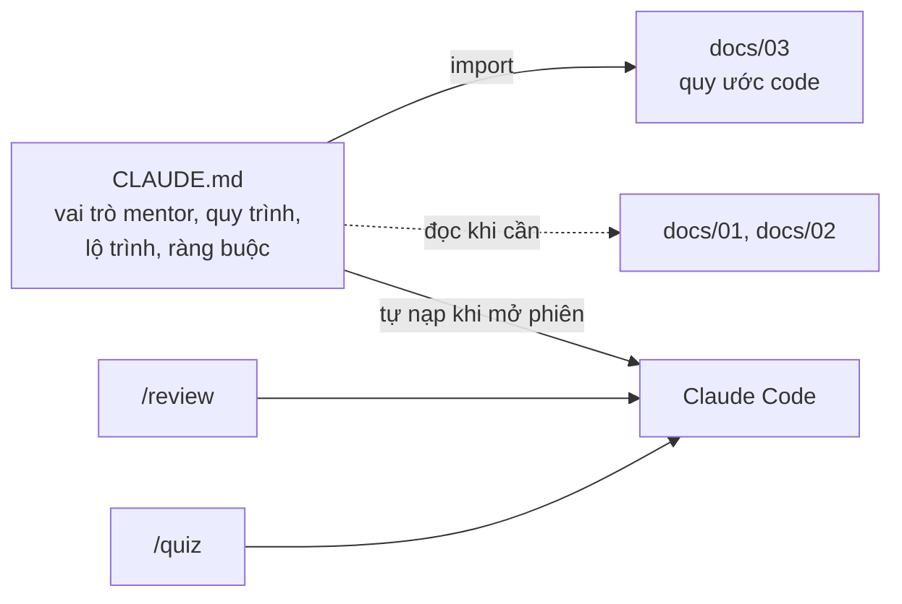
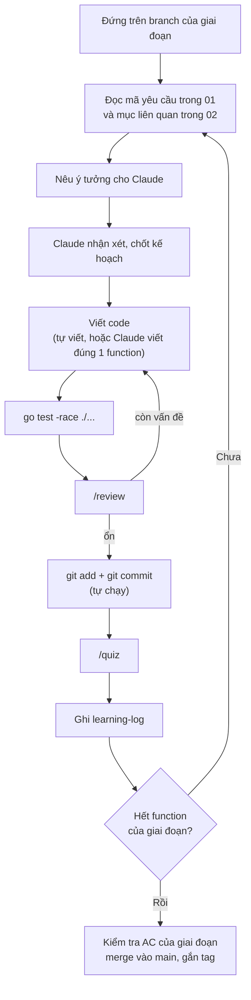
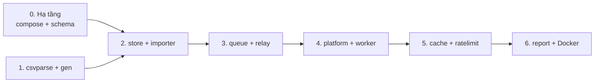

# Hướng dẫn bắt đầu: conversion-pipeline

Tài liệu này dành cho **người làm dự án**. Đọc file này trước tiên. Nó cho biết đọc tài liệu nào lúc nào, Claude Code đã được cài đặt gì trong repo, cách nhờ Claude Code giúp, và nên làm phần nào trước.

---

## 1. Bộ tài liệu và thứ tự đọc

| File | Dành cho | Nội dung | Cách đọc |
| --- | --- | --- | --- |
| `docs/00-getting-started.md` | Người | File này | Đọc hết, một lần |
| `docs/01-requirement-conversion-pipeline.md` | Người và Claude | **Yêu cầu**: làm gì, schema, hành vi từng chương trình, tiêu chí nghiệm thu | Mục 1–5 đọc trước; mục 6 đọc phần của giai đoạn đang làm |
| `docs/02-architecture-conversion-pipeline.md` | Người | **Vì sao** thiết kế như vậy, không làm vậy thì hỏng ra sao | Mục 1–2 đọc trước; các mục còn lại đọc khi làm tới phần liên quan |
| `docs/03-coding-guidelines.md` | Người và Claude | Quy ước code, Git | Lướt một lần; tra lại khi viết code |
| `docs/learning-log.md` | Người | Nhật ký những gì đã học | Ghi sau mỗi function |
| `CLAUDE.md` | Claude Code | Vai trò, quy trình, ràng buộc của Claude | Đọc một lần để biết Claude sẽ cư xử thế nào |

**Thứ tự đọc lần đầu, khoảng 1 giờ:**

1. File này.
2. `02` mục 1 (thay đổi tư duy từ mobile sang backend) và mục 2 (toàn cảnh).
3. `01` mục 1–5: mục tiêu, phạm vi, sơ đồ hệ thống, dữ liệu đầu vào, schema và trạng thái.
4. Lướt `03` để biết có những quy tắc nào.

### Mã yêu cầu

Tài liệu `01` gắn mã cho từng yêu cầu. Dùng chúng khi trao đổi với Claude Code để cả hai cùng nhìn vào một chỗ:

| Tiền tố | Nghĩa | Ví dụ |
| --- | --- | --- |
| `IMP-` | Yêu cầu của importer | IMP-4: pipeline goroutine |
| `REL-` | Yêu cầu của relay | REL-1: `SKIP LOCKED` |
| `WRK-` | Yêu cầu của worker | WRK-9: retry và backoff |
| `AC-` | Tiêu chí nghiệm thu | AC-5: kill worker giữa chừng không mất, không trùng |
| `GIT-` | Yêu cầu về Git | GIT-3: branch và tag theo giai đoạn |

### Giai đoạn nào đọc mục nào

| Giai đoạn | `01` | `02` | `03` |
| --- | --- | --- | --- |
| 0. Hạ tầng | 5, 9 | 2 | 12.1 |
| 1. csvparse, gen | 4 | 3 | 1, 2, 9 |
| 2. store, importer | 6.1 | 3, 4, 5, 6 | 3, 4, 5 |
| 3. queue, relay | 6.2 | 7, 8, 9 | 4, 5 |
| 4. platform, worker | 6.3, 6.4 | 9, 10, 11, 15, 16 | 4, 6, 7 |
| 5. cache, ratelimit | 6.3 (WRK-2, 4, 5, 11) | 12, 13, 14 | 4 |
| 6. report, Docker | 6.5, 9, 10 | 17, 18 | 8 |

---

## 2. Chuẩn bị môi trường

Kiểm tra các công cụ đã cài:

```bash
go version              # cần 1.22 trở lên
docker --version
docker compose version  # cần Compose v2
git --version
claude --version        # Claude Code
```

Khởi tạo repo theo `docs/03` mục 12.1 (`git init`, `go mod init`, commit đầu tiên).

---

## 3. Claude Code đã được cài đặt gì trong repo



| Thành phần | Vị trí | Tác dụng |
| --- | --- | --- |
| `CLAUDE.md` | Gốc repo | Claude Code tự đọc mỗi khi mở phiên. Biến Claude thành **mentor**: hỏi ý tưởng của bạn trước, chỉ viết đúng một function, giải thích sau khi viết, gợi ý trước khi đưa đáp án |
| Quy ước code | `docs/03`, được import vào `CLAUDE.md` | Claude luôn biết quy tắc đa luồng, `database/sql`, log, test, Git |
| Skill `/review` | `.claude/skills/review/` | Review code chưa commit, chạy `gofmt`, `go vet`, `go test -race`, gợi ý bằng câu hỏi |
| Skill `/quiz` | `.claude/skills/quiz/` | 4 câu hỏi kiểu phỏng vấn từ chính code vừa viết, chấm và đưa câu trả lời mẫu |
| `CLAUDE.local.md` | Gốc repo, bạn tự tạo nếu cần | Ghi chú cá nhân cho Claude, ví dụ "giải thích chậm hơn ở phần channel". Không được commit |

**Những gì Claude Code sẽ không tự làm:** thêm thư viện, dùng ORM, sửa schema hay yêu cầu trong `01`, xoá test, chạy lệnh xoá dữ liệu, commit, push.

**Kiểm tra cài đặt đã nhận:** mở Claude Code trong thư mục repo, gõ `/` để thấy `/review` và `/quiz` trong danh sách lệnh. Hỏi thử: *"Trong repo này bạn đóng vai trò gì và sẽ làm việc với mình theo quy trình nào?"*. Claude phải trả lời đúng vai trò mentor và quy trình 5 bước.

`CLAUDE.md` là ngữ cảnh, không phải cơ chế bắt buộc. Thỉnh thoảng Claude có thể làm quá phạm vi. Khi đó nhắc lại: *"Theo CLAUDE.md, chỉ viết function X thôi."*

---

## 4. Nhịp làm việc cho mỗi function



Một function chỉ xong khi bạn **tự giải thích được từng dòng**. Nếu chưa giải thích được, hỏi lại Claude cho tới khi hiểu, rồi mới commit.

---

## 5. Cách prompt Claude Code

### 5.1. Mẫu prompt

**Bắt đầu một phiên làm việc:**
```
Mình đang ở giai đoạn 2, branch stage-2-importer.
Hôm nay làm IMP-3 và IMP-4. Mình đã đọc 02 mục 3–4.
```

**Nhờ viết một function**, nêu đủ 4 ý:
```
Mục tiêu: hàm insertBatch trong internal/store (IMP-6).
Ý tưởng của mình: nhận []Row, dựng một câu INSERT IGNORE nhiều giá trị,
chạy trong transaction.
Chỗ mình chưa chắc: dựng chuỗi placeholder thế nào cho gọn,
có cần transaction khi chỉ có một câu lệnh không.
Phạm vi: chỉ hàm insertBatch, chưa cần test.
```

**Hỏi khái niệm:**
```
Giải thích vì sao lệnh gửi vào channel trong reader cần select với ctx.Done(),
dùng đúng code trong cmd/importer, so sánh với Swift nếu được.
```

**Khi gặp lỗi:**
```
go test -race báo lỗi dưới đây. Mình đã thử thêm mutex ở hàm X nhưng vẫn lỗi.
Đừng đưa đáp án vội, gợi ý mình chỗ cần xem.
<dán nguyên văn lỗi>
```

**Khi muốn có đáp án ngay:** thêm *"cho đáp án luôn"*.

**Review và quiz:**
```
/review
/review internal/csvparse/parse.go
/quiz
/quiz channel
```

### 5.2. Prompt nên tránh

| Tránh | Vì sao | Thay bằng |
| --- | --- | --- |
| "Viết toàn bộ importer" | Bạn nhận một khối code lớn mà không hiểu | Chia theo function, mỗi lần một mã yêu cầu |
| "Sửa lỗi giúp mình" (không kèm gì) | Claude phải đoán bối cảnh | Dán lỗi, nói đã thử gì |
| "Làm sao cho test pass" | Dễ dẫn tới sửa test thay vì sửa code | "Test X fail vì sao, code của mình sai ở đâu?" |
| "Tối ưu code này" | Mục tiêu mơ hồ | Nêu cụ thể: tốc độ, bộ nhớ, hay dễ đọc |
| "Làm cho production-ready", "thêm xử lý lỗi đầy đủ" | Claude dễ thêm abstraction, tuỳ chọn, retry không cần thiết, làm code khó đọc | Nêu đúng mã yêu cầu cần đạt, ví dụ "xử lý lỗi theo WRK-8 và WRK-9" |
| "Viết cho linh hoạt để sau này mở rộng" | Sinh ra interface, option "để sau này" mà không ai dùng | Chỉ viết cho yêu cầu hiện tại; khi có nhu cầu thật mới tách ra |

### 5.3. Mẹo

- **Mỗi function một phiên.** Xong một function thì dùng `/clear` để bắt đầu lại với ngữ cảnh sạch. `CLAUDE.md` vẫn được nạp lại.
- **Luôn kèm mã yêu cầu** (IMP-6, WRK-9...) để Claude đọc đúng chỗ trong `01`.
- **Tự viết trước khi nhờ.** Với hàm ngắn, thử tự viết rồi dùng `/review`. Bạn học được nhiều hơn so với đọc code Claude viết.
- **Hỏi "vì sao" nhiều hơn hỏi "làm sao".** Câu trả lời cho "vì sao" là thứ bạn sẽ dùng khi phỏng vấn.

---

## 6. Kế hoạch triển khai



Giai đoạn 0 và 1 độc lập nhau, làm cái nào trước cũng được. Từ giai đoạn 2 trở đi phải làm theo thứ tự.

| Giai đoạn | Branch | Làm gì | Mã yêu cầu | Xong khi | Thời gian ước tính |
| --- | --- | --- | --- | --- | --- |
| 0 | `stage-0-infra` | `compose.yaml` chỉ gồm mysql, redis, pubsub, wiremock; `migrations/`; 4 mapping WireMock | `01` mục 5, 6.4, 9 | Bảng có trong MySQL, `redis-cli ping` ra `PONG`, lệnh `curl` ở `01` mục 6.4 trả `cv_T1` | 0,5 ngày |
| 1 | `stage-1-csvparse` | `internal/csvparse` (parse, validate), `cmd/gen` | `01` mục 4 | AC-12 | 0,5 ngày |
| 2 | `stage-2-importer` | `internal/config`, `internal/source`, `internal/store`, `cmd/importer`: bản viết tay trước, `errgroup` sau | IMP-1 → IMP-9 | AC-3, AC-4, AC-11 | 1 ngày |
| 3 | `stage-3-relay` | `internal/queue`, `cmd/relay` | REL-1 → REL-7 | Dòng chuyển `PENDING` → `PUBLISHED`; chạy hai relay cùng lúc không publish trùng | 0,5 ngày |
| 4 | `stage-4-worker` | `internal/platform`, `cmd/worker` (chưa có Redis) | WRK-1, 3, 6–10, 12, 13 | AC-2, AC-5, AC-9, AC-10 (chạy 3 worker ở 3 cửa sổ terminal) | 1 ngày |
| 5 | `stage-5-redis` | `internal/cache`, `internal/ratelimit`, bộ đếm lượt gọi | WRK-2, 4, 5, 11 | AC-6, AC-7, AC-8 | 0,5 ngày |
| 6 | `stage-6-docker` | `cmd/report`, `Dockerfile`, thêm relay, worker, importer, report vào `compose.yaml`, `README.md` | `01` mục 6.5, 9, 10, 12 | AC-1 và chạy lại toàn bộ AC bằng Docker Compose | 0,5–1 ngày |

### Chạy các chương trình Go trực tiếp ở giai đoạn 1–5

Từ giai đoạn 0, hạ tầng chạy trong Docker và mở cổng ra máy (3306, 6379, 8085, 8080). Các chương trình Go chạy bằng `go run` để sửa và chạy lại nhanh, không phải build image. Chỉ cần trỏ cấu hình về `localhost`:

```bash
export MYSQL_DSN='app:app@tcp(localhost:3306)/pipeline?parseTime=true'
export REDIS_ADDR=localhost:6379
export PUBSUB_EMULATOR_HOST=localhost:8085
export PUBSUB_PROJECT_ID=demo
export PLATFORM_URL=http://localhost:8080

go run ./cmd/importer -file data/orders.csv
go run ./cmd/relay
go run ./cmd/worker      # mở thêm terminal và chạy lệnh này lần nữa để có 2, 3 worker
```

Có thể lưu khối `export` vào file `.env.local` (đã nằm trong `.gitignore`) rồi chạy `source .env.local` mỗi khi mở terminal mới.

Giai đoạn 6 mới đưa các chương trình vào Docker, và từ đó dùng đúng các lệnh ở `01` mục 10.

### Khi xong một giai đoạn

- [ ] Các AC của giai đoạn đều đạt.
- [ ] `/review` trên toàn bộ thay đổi của branch không còn vấn đề nghiêm trọng.
- [ ] `/quiz` cho phần quan trọng nhất của giai đoạn.
- [ ] `learning-log.md` có ghi các khái niệm mới.
- [ ] Merge vào `main` với `--no-ff`, gắn tag `stage-N` (`03` mục 12.2).

---

## 7. Khi gặp vấn đề

| Hiện tượng | Nguyên nhân thường gặp | Cách xử lý |
| --- | --- | --- |
| `bad connection` hoặc `unexpected EOF` khi kết nối MySQL | MySQL chưa khởi động xong | `docker compose ps`, đợi cột STATUS là `healthy` |
| `address already in use` ở cổng 3306 hoặc 8080 | Máy đang chạy sẵn MySQL hoặc chương trình khác | Tắt chương trình đó, hoặc đổi cổng phía host trong `compose.yaml` và cập nhật biến môi trường |
| Job không bao giờ về `DONE`, còn dòng kẹt ở `PUBLISHED` | Container Pub/Sub emulator đã khởi động lại, message mất | Chạy lại từ đầu với `docker compose down -v` (`02` mục 9) |
| Bảng không tồn tại sau khi sửa file trong `migrations/` | MySQL chỉ chạy file khởi tạo khi volume còn trống | `docker compose down -v` rồi `up` lại |
| `go: missing go.sum entry` | Chưa tải dependency | `go mod tidy` |
| Claude viết quá nhiều code hoặc tự thêm thư viện | Claude chưa bám sát `CLAUDE.md` | Nhắc lại phạm vi; nếu lặp lại, ghi thêm vào `CLAUDE.local.md` |
| Không hiểu đoạn Claude viết | | Đừng commit. Hỏi lại từng dòng, hoặc nhờ viết lại đơn giản hơn |
