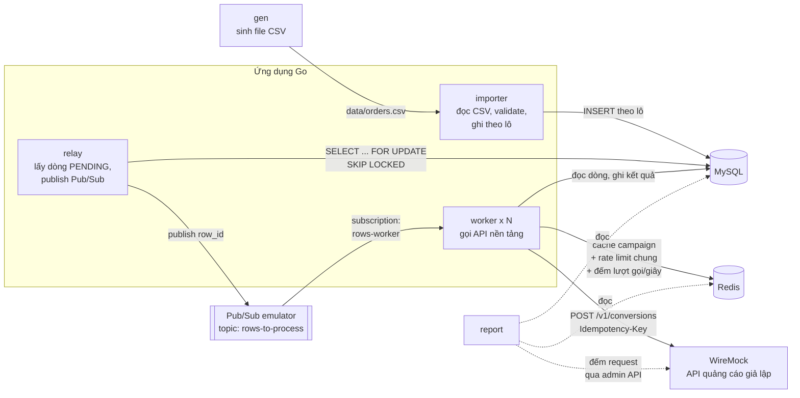
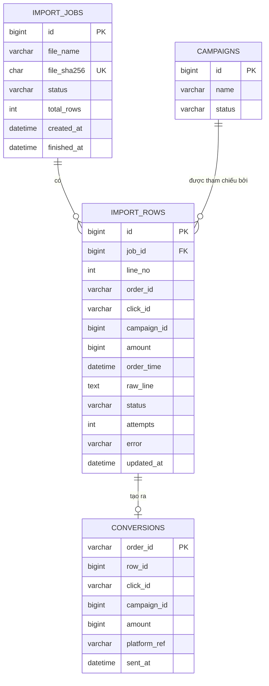
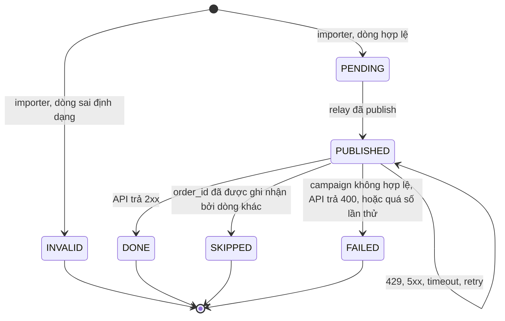
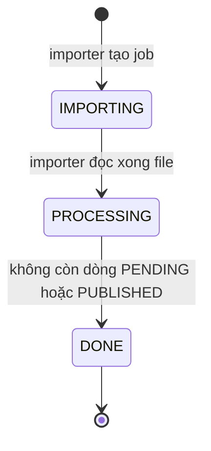
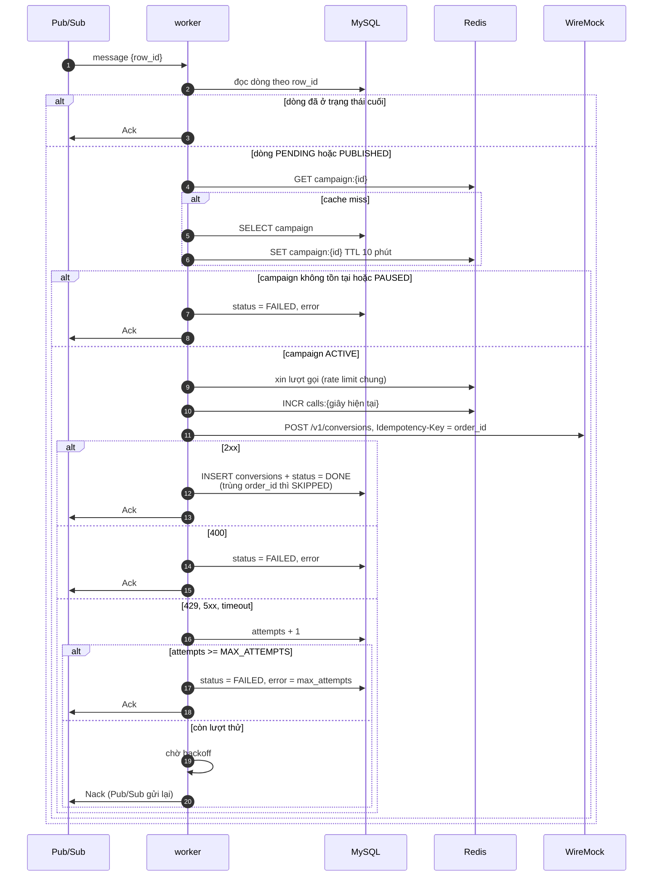

# Yêu cầu sản phẩm demo: Conversion Pipeline

| Mục | Nội dung |
| --- | --- |
| Tên dự án | `conversion-pipeline` |
| Loại | Demo kỹ thuật backend (Go), chạy hoàn toàn trên máy local bằng Docker Compose |
| Ngôn ngữ | Go 1.22 trở lên |
| Công cụ cần có | Go, Docker (kèm Docker Compose v2). **Không dùng Makefile**: mọi thao tác chạy bằng lệnh `go` và `docker compose` |
| Thời gian dự kiến | Khoảng 3 ngày làm việc |
| Tài liệu đi kèm | `00-getting-started.md`: hướng dẫn bắt đầu và kế hoạch theo giai đoạn. `04-design-story.md`: câu chuyện bài toán thực tế và các sự cố production dẫn tới thiết kế này. `02-architecture-conversion-pipeline.md`: chi tiết kỹ thuật của từng quyết định. `03-coding-guidelines.md`: quy ước code. `CLAUDE.md`: hướng dẫn cho Claude Code |

---

## 1. Mục tiêu

Xây dựng một pipeline xử lý **file CSV lớn chứa đơn hàng offline** (đơn hàng phát sinh ngoài website, có gắn click ID của quảng cáo) và gửi từng đơn hợp lệ tới **API của một nền tảng quảng cáo**, được giả lập bằng **WireMock**.

Demo phải chứng minh được các năng lực sau:

1. Đọc file rất lớn mà bộ nhớ không tăng theo kích thước file.
2. Xử lý song song bằng goroutine trong một tiến trình, và scale ngang bằng nhiều instance.
3. Chạy lại hoặc bị dừng giữa chừng vẫn **không mất dữ liệu và không ghi nhận trùng**.
4. Phân biệt lỗi dữ liệu, lỗi bị từ chối và lỗi tạm thời, xử lý đúng từng loại.
5. Dùng Redis đúng chỗ: **cache dữ liệu tham chiếu** và **giới hạn tốc độ chung** cho nhiều worker.

## 2. Phạm vi

### Trong phạm vi

- 3 chương trình xử lý chính: `importer`, `relay`, `worker`.
- 2 chương trình phụ trợ: `gen` (sinh file CSV mẫu), `report` (in báo cáo).
- Hạ tầng local: MySQL 8, Redis 7, Pub/Sub emulator, WireMock 3.
- Tài liệu `README.md` liệt kê đầy đủ lệnh chạy demo.

### Ngoài phạm vi

- Makefile hay script build riêng.
- Upload file từ người dùng, giao diện web, xác thực người dùng.
- Google Cloud Storage thật, thông báo tự động từ GCS. File được đọc từ thư mục local, qua một interface để sau này thay bằng GCS.
- Deploy lên cloud, Kubernetes, monitoring bằng Prometheus hay Grafana.
- Công cụ migration. Schema được nạp bằng file SQL khi MySQL khởi động lần đầu.
- Mô phỏng hành vi có trạng thái của API thật (giới hạn tốc độ phía server, ghi nhớ Idempotency-Key). WireMock chỉ trả response cố định theo quy tắc ở mục 6.4.

## 3. Tổng quan hệ thống



## 4. Dữ liệu đầu vào

### 4.1. Định dạng file CSV

- Mã hoá UTF-8, dấu phân cách là dấu phẩy, dòng đầu tiên là header.
- Số dòng được tính từ 1, kể cả header. Dòng dữ liệu đầu tiên có `line_no = 2`.

| Cột | Kiểu | Bắt buộc | Quy tắc hợp lệ |
| --- | --- | --- | --- |
| `order_id` | chuỗi | Có | 1–64 ký tự |
| `click_id` | chuỗi | Có | 1–128 ký tự |
| `campaign_id` | số nguyên | Có | Lớn hơn 0 |
| `amount` | số nguyên (VND) | Có | Lớn hơn 0 |
| `order_time` | thời gian | Có | Định dạng RFC 3339, ví dụ `2026-11-13T19:20:00+07:00` |

Ví dụ:

```csv
order_id,click_id,campaign_id,amount,order_time
A000001,clk_9f1c2,17,350000,2026-11-13T19:20:00+07:00
A000002,clk_7c2aa,42,120000,2026-11-13T20:05:00+07:00
```

### 4.2. Chương trình sinh dữ liệu `gen`

```bash
go run ./cmd/gen -rows 20000 -out data/orders.csv -seed 42
```

- Chạy trực tiếp trên máy, không cần hạ tầng.
- `-seed` cố định để cùng tham số luôn sinh ra cùng một file.
- `campaign_id` được chọn ngẫu nhiên trong khoảng 1–220. Bảng `campaigns` chỉ có id 1–200, nên khoảng 9% dòng trỏ tới campaign không tồn tại.
- File phải chứa sẵn các tình huống sau, theo tỉ lệ xấp xỉ:

| Tình huống | Tỉ lệ | Kết quả mong đợi |
| --- | --- | --- |
| Thiếu `click_id` | 1% | `INVALID` |
| `amount` không phải số hoặc ≤ 0 | 0,5% | `INVALID` |
| `order_time` sai định dạng | 0,5% | `INVALID` |
| Trùng `order_id` với một dòng khác trong file (dòng trùng giữ nguyên các cột còn lại) | 1% | Dòng ghi nhận thành công trước là `DONE`, các dòng trùng còn lại `SKIPPED` |
| `click_id` bắt đầu bằng `clk_old` | 1% | WireMock trả 400, dòng `FAILED` (`click_expired`) |
| `click_id` bắt đầu bằng `clk_err` | 0,2% | WireMock luôn trả 500; worker retry đủ `MAX_ATTEMPTS` lần rồi `FAILED` (`max_attempts`) |
| `campaign_id` không tồn tại (201–220) | khoảng 9% | `FAILED` (`campaign_not_found`) |
| `campaign_id` thuộc campaign đang `PAUSED` | theo dữ liệu seed | `FAILED` (`campaign_paused`) |

## 5. Mô hình dữ liệu



### 5.1. Schema (`migrations/01_schema.sql`)

```sql
CREATE TABLE campaigns (
  id      BIGINT PRIMARY KEY,
  name    VARCHAR(255) NOT NULL,
  status  ENUM('ACTIVE', 'PAUSED') NOT NULL
);

CREATE TABLE import_jobs (
  id           BIGINT AUTO_INCREMENT PRIMARY KEY,
  file_name    VARCHAR(512) NOT NULL,
  file_sha256  CHAR(64) NOT NULL,
  status       VARCHAR(20) NOT NULL,           -- IMPORTING | PROCESSING | DONE
  total_rows   INT NOT NULL DEFAULT 0,
  created_at   DATETIME NOT NULL DEFAULT CURRENT_TIMESTAMP,
  finished_at  DATETIME NULL,
  UNIQUE KEY uq_file (file_sha256)              -- cùng một nội dung file chỉ là một job
);

CREATE TABLE import_rows (
  id           BIGINT AUTO_INCREMENT PRIMARY KEY,
  job_id       BIGINT NOT NULL,
  line_no      INT NOT NULL,
  order_id     VARCHAR(64) NULL,
  click_id     VARCHAR(128) NULL,
  campaign_id  BIGINT NULL,
  amount       BIGINT NULL,
  order_time   DATETIME NULL,                   -- lưu theo UTC
  raw_line     TEXT NOT NULL,
  status       VARCHAR(20) NOT NULL,           -- xem mục 5.2
  attempts     INT NOT NULL DEFAULT 0,
  error        VARCHAR(255) NULL,
  updated_at   DATETIME NOT NULL DEFAULT CURRENT_TIMESTAMP ON UPDATE CURRENT_TIMESTAMP,
  UNIQUE KEY uq_job_line (job_id, line_no),     -- chạy lại importer không tạo dòng trùng
  KEY idx_status (status, id),                  -- relay tìm dòng PENDING
  KEY idx_job_status (job_id, status)           -- báo cáo theo job
);

CREATE TABLE conversions (
  order_id      VARCHAR(64) PRIMARY KEY,        -- chốt chặn cuối cùng chống ghi nhận trùng
  row_id        BIGINT NOT NULL,
  click_id      VARCHAR(128) NOT NULL,
  campaign_id   BIGINT NOT NULL,
  amount        BIGINT NOT NULL,
  platform_ref  VARCHAR(64) NOT NULL,
  sent_at       DATETIME NOT NULL DEFAULT CURRENT_TIMESTAMP
);
```

File `migrations/02_seed.sql` tạo 200 campaign (id 1–200), trong đó 20 campaign có `status = 'PAUSED'`. Tiền tố số trong tên file đảm bảo MySQL chạy schema trước seed.

### 5.2. Trạng thái của một dòng



`INVALID`, `DONE`, `SKIPPED`, `FAILED` là **trạng thái cuối**. Một dòng đã ở trạng thái cuối thì không bao giờ bị xử lý lại.

### 5.3. Trạng thái của một job



## 6. Yêu cầu chức năng

### 6.1. `importer`

Chạy một lần cho mỗi file:

```bash
docker compose run --rm importer -file /data/orders.csv
```

| Mã | Yêu cầu |
| --- | --- |
| IMP-1 | Tính SHA-256 của file bằng cách đọc streaming. Nếu đã có job với cùng `file_sha256` ở trạng thái `PROCESSING` hoặc `DONE`, in thông báo và thoát với mã 0, không làm gì thêm. |
| IMP-2 | Nếu chưa có job, tạo job mới với `status = 'IMPORTING'`. Nếu đã có job ở `IMPORTING` (lần trước bị dừng giữa chừng), dùng lại job đó. |
| IMP-3 | Đọc file **streaming từng dòng**, không được đọc toàn bộ file vào bộ nhớ. |
| IMP-4 | Xử lý theo pipeline: 1 goroutine đọc, `IMPORT_PARSERS` goroutine parse và validate (mặc định 4), 1 goroutine gom lô và ghi DB. Các bước nối với nhau bằng buffered channel. Lỗi ở một bước phải huỷ các bước còn lại. Viết bản đầu tiên bằng công cụ có sẵn (`sync.WaitGroup`, `context.WithCancel`, `sync.Once`); khi bản này chạy đúng mới được chuyển sang `errgroup`. |
| IMP-5 | Dòng hợp lệ lưu với `status = 'PENDING'`. Dòng sai lưu với `status = 'INVALID'`, có `error` mô tả lý do, ví dụ `missing click_id`. Mọi dòng đều lưu `raw_line`. |
| IMP-6 | Ghi theo lô `IMPORT_BATCH_SIZE` dòng (mặc định 500) bằng một câu `INSERT IGNORE` nhiều giá trị. Chạy lại trên cùng job không tạo dòng trùng, nhờ khoá `(job_id, line_no)`. |
| IMP-7 | Đọc xong: cập nhật `total_rows` và chuyển job sang `PROCESSING`. |
| IMP-8 | Nhận `SIGINT`/`SIGTERM` thì dừng đọc, ghi nốt lô đang gom, rồi thoát. Job giữ nguyên `IMPORTING` để lần chạy sau tiếp tục. |
| IMP-9 | Phần đọc file đi qua interface `Source` (`Open(ctx, name) (io.ReadCloser, error)`). Demo chỉ cần cài đặt cho file local. |

### 6.2. `relay`

Chạy liên tục như một service trong Docker Compose.

| Mã | Yêu cầu |
| --- | --- |
| REL-1 | Mỗi `RELAY_INTERVAL` (mặc định 1 giây), mở transaction và lấy tối đa `RELAY_BATCH_SIZE` dòng (mặc định 500): `SELECT id, job_id FROM import_rows WHERE status = 'PENDING' ORDER BY id LIMIT ? FOR UPDATE SKIP LOCKED`. |
| REL-2 | Publish mỗi dòng thành một message lên topic `rows-to-process`. Data là JSON `{"row_id": 123}`, attribute `job_id`. Chờ **toàn bộ** kết quả publish của lô thành công. |
| REL-3 | Cập nhật các dòng đó sang `PUBLISHED` rồi commit. Nếu có lỗi publish, rollback để lô được lấy lại ở vòng sau. |
| REL-4 | Nhiều instance relay chạy cùng lúc phải an toàn (đảm bảo nhờ `SKIP LOCKED`). |
| REL-5 | Mỗi 5 giây, chuyển các job `PROCESSING` không còn dòng `PENDING` hay `PUBLISHED` sang `DONE` và ghi `finished_at`. |
| REL-6 | Khi khởi động, tạo topic và subscription nếu chưa có. Emulator không tự tạo hai thứ này. |
| REL-7 | Graceful shutdown: hoàn tất transaction đang dở rồi mới thoát. |

### 6.3. `worker`

Chạy liên tục, subscribe `rows-worker`. Phải chạy đúng khi scale nhiều instance (`docker compose up -d --scale worker=3`).



| Mã | Yêu cầu |
| --- | --- |
| WRK-1 | Đọc dòng theo `row_id`. Nếu dòng ở trạng thái cuối thì Ack, không làm gì thêm. Dòng ở `PENDING` **hoặc** `PUBLISHED` đều được xử lý (worker có thể nhận message trước khi relay kịp commit `PUBLISHED`). |
| WRK-2 | Lấy campaign qua **cache-aside Redis**: key `campaign:{id}`, TTL `CACHE_TTL` (mặc định 10 phút). Campaign không tồn tại cũng được cache (giá trị đánh dấu "không tồn tại") để không truy vấn DB lặp lại. Redis lỗi thì đọc thẳng MySQL, không được làm hỏng việc xử lý. |
| WRK-3 | Campaign không tồn tại thì `FAILED` với `error = 'campaign_not_found'`; campaign `PAUSED` thì `FAILED` với `error = 'campaign_paused'`. Không gọi API. |
| WRK-4 | Trước mỗi lần gọi API, xin lượt từ **rate limiter dùng chung trên Redis** (key `rate:adplatform`, giới hạn `RATE_LIMIT_RPS`, mặc định 200/giây), dùng thư viện `github.com/go-redis/redis_rate/v10`. Biến `RATE_LIMIT_ENABLED=false` tắt rate limiter để demo so sánh. |
| WRK-5 | Ngay trước mỗi lần gọi API, tăng bộ đếm `calls:{unix_second}` trong Redis bằng `INCR`, đặt `EXPIRE` 1 giờ. Bộ đếm này đo tổng số lượt gọi mỗi giây của **mọi** worker cộng lại, dùng để kiểm chứng rate limiter. |
| WRK-6 | Gọi `POST {PLATFORM_URL}/v1/conversions` với header `Idempotency-Key: <order_id>`, timeout HTTP 5 giây. |
| WRK-7 | Nhận 2xx: lấy `conversion_id` từ response, rồi trong một transaction `INSERT` vào `conversions` và chuyển dòng sang `DONE`. Nếu `INSERT` lỗi trùng khoá chính (MySQL 1062), chuyển dòng sang `SKIPPED` với `error = 'duplicate order_id'`. Sau đó Ack. |
| WRK-8 | Nhận 400: `FAILED`, lưu mã lỗi trong body response vào `error`, Ack. |
| WRK-9 | Nhận 429, 5xx, timeout, lỗi mạng: tăng `attempts`. Nếu `attempts >= MAX_ATTEMPTS` (mặc định 5) thì `FAILED` với `error = 'max_attempts'` và Ack. Nếu chưa thì chờ backoff `min(500ms × 2^attempts, 10s)` rồi Nack. |
| WRK-10 | Giới hạn số message xử lý đồng thời mỗi instance bằng `WORKER_MAX_OUTSTANDING` (mặc định 100). |
| WRK-11 | Đếm cache hit/miss bằng `atomic` trong bộ nhớ, cứ 5 giây cộng dồn vào Redis hash `stats:worker` bằng `HINCRBY`, và cộng nốt khi tắt. |
| WRK-12 | Graceful shutdown: ngừng nhận message mới, chờ các message đang xử lý xong, rồi thoát. |
| WRK-13 | Log có cấu trúc bằng `log/slog`, mỗi dòng log về một bản ghi phải có `job_id`, `row_id`, `order_id`. |

### 6.4. API nền tảng quảng cáo giả lập bằng WireMock

Dùng image `wiremock/wiremock` bản 3.x (ghi tag cụ thể trong `compose.yaml`), cổng 8080. Toàn bộ hành vi định nghĩa bằng file JSON trong `wiremock/mappings/`. WireMock **không lưu trạng thái**: mỗi request được trả lời chỉ dựa trên nội dung của chính nó.

**Request worker gửi:**
```http
POST /v1/conversions
Content-Type: application/json
Idempotency-Key: A000001

{
  "order_id": "A000001",
  "click_id": "clk_9f1c2",
  "campaign_id": 17,
  "amount": 350000,
  "order_time": "2026-11-13T12:20:00Z"
}
```

**Bốn mapping cần có.** Số `priority` nhỏ hơn được ưu tiên khớp trước.

| File | Priority | Điều kiện khớp | Response |
| --- | --- | --- | --- |
| `01-click-expired.json` | 1 | `click_id` bắt đầu bằng `clk_old` | `400 {"error":"click_expired"}` |
| `02-server-error.json` | 1 | `click_id` bắt đầu bằng `clk_err` | `500 {"error":"internal"}` |
| `03-success.json` | 5 | Có header `Idempotency-Key` | `200 {"conversion_id":"cv_<order_id>"}` |
| `04-missing-key.json` | 10 | Mọi `POST /v1/conversions` còn lại | `400 {"error":"missing_idempotency_key"}` |

`conversion_id` được tạo từ `order_id` bằng response templating, nên cùng một đơn hàng luôn nhận cùng một mã.

Ví dụ `wiremock/mappings/01-click-expired.json`:
```json
{
  "priority": 1,
  "request": {
    "method": "POST",
    "url": "/v1/conversions",
    "bodyPatterns": [
      { "matchesJsonPath": { "expression": "$.click_id", "matches": "^clk_old.*" } }
    ]
  },
  "response": {
    "status": 400,
    "headers": { "Content-Type": "application/json" },
    "jsonBody": { "error": "click_expired" }
  }
}
```

Ví dụ `wiremock/mappings/03-success.json`:
```json
{
  "priority": 5,
  "request": {
    "method": "POST",
    "url": "/v1/conversions",
    "headers": { "Idempotency-Key": { "matches": ".+" } }
  },
  "response": {
    "status": 200,
    "headers": { "Content-Type": "application/json" },
    "body": "{\"conversion_id\":\"cv_{{jsonPath request.body '$.order_id'}}\"}",
    "transformers": ["response-template"]
  }
}
```

Kiểm tra nhanh sau khi hạ tầng chạy:
```bash
curl -s -X POST localhost:8080/v1/conversions \
  -H 'Content-Type: application/json' -H 'Idempotency-Key: T1' \
  -d '{"order_id":"T1","click_id":"clk_abc","campaign_id":1,"amount":1000,"order_time":"2026-11-13T12:00:00Z"}'
# Kết quả mong đợi: {"conversion_id":"cv_T1"}
```

**Những gì WireMock không mô phỏng, và cách demo bù lại:**

| Hành vi của API thật | Trong demo |
| --- | --- |
| Trả 429 khi bị gọi quá nhanh | Không có. Rate limiter được kiểm chứng bằng bộ đếm `calls:{giây}` ở WRK-5 |
| Ghi nhớ Idempotency-Key, không ghi nhận trùng | Không có. Khoá chính `order_id` trong `conversions` là chốt chặn chống trùng |
| Lỗi tạm thời rồi tự hết | Không có. `clk_err` luôn lỗi, dùng để kiểm chứng retry và giới hạn số lần thử |

Code worker vẫn phải xử lý 429 như lỗi tạm thời (WRK-9), vì API thật có trả mã này.

### 6.5. `report`

```bash
docker compose run --rm report             # báo cáo job mới nhất
docker compose run --rm report -job 1      # báo cáo một job cụ thể
docker compose run --rm report -wait       # chờ đến khi job mới nhất DONE rồi mới in
```

In ra:
```
Job 1  file=/data/orders.csv  status=DONE  duration=2m05s
  total    20000
  done     xxxxx
  skipped  xxxxx
  failed   xxxxx   (campaign_not_found=..., campaign_paused=..., click_expired=..., max_attempts=...)
  invalid  xxxxx
  check    done + skipped + failed + invalid = total  -> OK
Redis cache    hits=xxxxx  misses=xxx
API calls/sec  peak=xxx  limit=200  (từ calls:* trong Redis)
WireMock       POST /v1/conversions received=xxxxx
Conversions    rows in table = xxxxx   (phải bằng số dòng DONE)
```

- Đỉnh lượt gọi mỗi giây: quét các key `calls:*` bằng `SCAN` và lấy giá trị lớn nhất.
- Số request WireMock nhận: gọi admin API `POST /__admin/requests/count` với body `{"method":"POST","url":"/v1/conversions"}`.
- Số request WireMock nhận sẽ **lớn hơn** số dòng `DONE`, vì có retry (`clk_err`), có dòng bị từ chối (`clk_old`) và có dòng trùng. Đây là kết quả đúng, cần giải thích trong README.

## 7. Cấu hình

Mọi cấu hình đọc từ biến môi trường. `compose.yaml` khai báo giá trị mặc định theo dạng `${TÊN_BIẾN:-mặc_định}`, nên có thể ghi đè ngay trên dòng lệnh, ví dụ `RATE_LIMIT_ENABLED=false docker compose up -d`.

| Biến | Mặc định | Dùng bởi |
| --- | --- | --- |
| `MYSQL_DSN` | `app:app@tcp(mysql:3306)/pipeline?parseTime=true` | importer, relay, worker, report |
| `MYSQL_MAX_OPEN_CONNS` | `10` | importer, relay, worker, report |
| `REDIS_ADDR` | `redis:6379` | worker, report |
| `PUBSUB_EMULATOR_HOST` | `pubsub:8085` | relay, worker |
| `PUBSUB_PROJECT_ID` | `demo` | relay, worker |
| `PUBSUB_TOPIC` | `rows-to-process` | relay |
| `PUBSUB_SUBSCRIPTION` | `rows-worker` | relay (tạo), worker |
| `IMPORT_BATCH_SIZE` | `500` | importer |
| `IMPORT_PARSERS` | `4` | importer |
| `RELAY_BATCH_SIZE` | `500` | relay |
| `RELAY_INTERVAL` | `1s` | relay |
| `PLATFORM_URL` | `http://wiremock:8080` | worker, report |
| `RATE_LIMIT_ENABLED` | `true` | worker |
| `RATE_LIMIT_RPS` | `200` | worker, report |
| `CACHE_TTL` | `10m` | worker |
| `WORKER_MAX_OUTSTANDING` | `100` | worker |
| `MAX_ATTEMPTS` | `5` | worker |

## 8. Cấu trúc repo

```
conversion-pipeline/
├── .gitignore
├── CLAUDE.md             # hướng dẫn cho Claude Code (vai trò mentor, ràng buộc)
├── .claude/
│   └── skills/
│       ├── review/SKILL.md   # /review: review code theo docs/03
│       └── quiz/SKILL.md     # /quiz: câu hỏi phỏng vấn từ code vừa viết
├── docs/
│   ├── 00-getting-started.md
│   ├── 01-requirement-conversion-pipeline.md
│   ├── 02-architecture-conversion-pipeline.md
│   ├── 03-coding-guidelines.md
│   ├── 04-design-story.md
│   └── learning-log.md
├── cmd/
│   ├── gen/              # sinh file CSV mẫu
│   ├── importer/
│   ├── relay/
│   ├── worker/
│   └── report/
├── internal/
│   ├── config/           # đọc biến môi trường
│   ├── csvparse/         # parse + validate (+ test)
│   ├── source/           # interface Source + cài đặt file local
│   ├── store/            # truy vấn MySQL
│   ├── queue/            # publish/subscribe Pub/Sub
│   ├── cache/            # cache-aside campaign (Redis)
│   ├── ratelimit/        # rate limiter chung (Redis)
│   └── platform/         # HTTP client gọi API nền tảng
├── migrations/
│   ├── 01_schema.sql
│   └── 02_seed.sql
├── wiremock/
│   └── mappings/         # 4 file JSON ở mục 6.4
├── data/                 # file CSV sinh ra (không commit, chỉ giữ data/.gitkeep)
├── Dockerfile            # multi-stage, build tất cả binary trong cmd/ (trừ gen)
├── compose.yaml
├── go.mod
└── README.md
```

### Thư viện

| Mục đích | Thư viện |
| --- | --- |
| MySQL | `github.com/go-sql-driver/mysql` |
| Redis | `github.com/redis/go-redis/v9` |
| Rate limiter trên Redis | `github.com/go-redis/redis_rate/v10` |
| Pub/Sub | `cloud.google.com/go/pubsub` (ghi rõ bản v1 hay v2 trong README) |
| Chạy song song có huỷ | Công cụ có sẵn của Go trước; `golang.org/x/sync/errgroup` sau khi bản viết tay chạy đúng |
| Truy cập DB | `database/sql` (thư viện chuẩn), SQL viết tay trong `internal/store` |
| Log | `log/slog` (thư viện chuẩn) |

**Không dùng:** ORM (GORM...), thư viện worker pool (`ants`, `conc`, `tunny`...), framework web. Thêm thư viện ngoài danh sách phải thống nhất trước, xem `docs/03-coding-guidelines.md`.

## 9. Docker Compose

### 9.1. Các service

| Service | Image / build | Chạy khi nào | Ghi chú |
| --- | --- | --- | --- |
| `mysql` | `mysql:8.4` | `docker compose up` | Biến môi trường `MYSQL_DATABASE=pipeline`, `MYSQL_USER=app`, `MYSQL_PASSWORD=app`, `MYSQL_ROOT_PASSWORD=root`. Mount `migrations/` vào `/docker-entrypoint-initdb.d/`. Có `healthcheck`. Map cổng 3306 ra host |
| `redis` | `redis:7` | `docker compose up` | Map cổng 6379 ra host |
| `pubsub` | `gcr.io/google.com/cloudsdktool/google-cloud-cli:emulators` | `docker compose up` | Lệnh: `gcloud beta emulators pubsub start --project=demo --host-port=0.0.0.0:8085`. Map cổng 8085 |
| `wiremock` | `wiremock/wiremock:<tag 3.x>` | `docker compose up` | Mount `wiremock/mappings/` vào `/home/wiremock/mappings`. Map cổng 8080 |
| `relay` | build từ `Dockerfile` | `docker compose up` | `depends_on`: mysql `service_healthy`, pubsub |
| `worker` | build từ `Dockerfile` | `docker compose up` | `depends_on` như relay, thêm redis, wiremock. **Không** đặt `container_name`, **không** map cổng ra host, để chạy được `--scale` |
| `importer` | build từ `Dockerfile` | `docker compose run` | `profiles: ["tools"]`. Mount `./data` vào `/data` (chỉ đọc) |
| `report` | build từ `Dockerfile` | `docker compose run` | `profiles: ["tools"]` |

Service có `profiles: ["tools"]` không khởi động khi chạy `docker compose up`, mà chỉ chạy khi gọi tên trực tiếp bằng `docker compose run`.

### 9.2. Dockerfile

- Stage build dùng image `golang`, build các binary `importer`, `relay`, `worker`, `report` vào `/app/`.
- Stage chạy dùng image nhỏ (ví dụ `gcr.io/distroless/static-debian12`), copy `/app/`.
- Mỗi service trong `compose.yaml` chọn binary bằng `entrypoint`, ví dụ `entrypoint: ["/app/worker"]`. Nhờ vậy `docker compose run --rm importer -file /data/orders.csv` truyền thẳng tham số cho binary.

## 10. Lệnh chạy

Toàn bộ chạy từ thư mục gốc của repo.

### 10.1. Kịch bản demo đầy đủ

```bash
# 1. Sinh dữ liệu (chạy trực tiếp bằng Go, không cần hạ tầng)
go run ./cmd/gen -rows 20000 -out data/orders.csv -seed 42

# 2. Build và khởi động hạ tầng + relay + 1 worker, chờ healthcheck đạt
docker compose up -d --build --wait

# 3. Nạp file
docker compose run --rm importer -file /data/orders.csv

# 4. Scale lên 3 worker
docker compose up -d --scale worker=3 --no-recreate

# 5. Chờ job xong rồi in báo cáo
docker compose run --rm report -wait

# 6. Dọn dẹp (xoá cả dữ liệu MySQL)
docker compose down -v
```

### 10.2. Lệnh thường dùng khi phát triển

| Việc | Lệnh |
| --- | --- |
| Chạy unit test | `go test -race ./...` |
| Kiểm tra code | `go vet ./...` |
| Build toàn bộ trên máy | `go build ./...` |
| Xem log worker | `docker compose logs -f worker` |
| Xem log một service | `docker compose logs -f relay` |
| Trạng thái các service | `docker compose ps` |
| Vào MySQL | `docker compose exec mysql mysql -uapp -papp pipeline` |
| Vào Redis | `docker compose exec redis redis-cli` |
| Build lại sau khi sửa code | `docker compose up -d --build` |
| Tắt rate limiter để so sánh | `RATE_LIMIT_ENABLED=false docker compose up -d --scale worker=3` |

## 11. Tiêu chí nghiệm thu

| Mã | Kịch bản | Kết quả mong đợi |
| --- | --- | --- |
| AC-1 | Trên máy chỉ có Go và Docker, chạy đúng các lệnh ở mục 10.1 | Chạy hết không lỗi, in báo cáo |
| AC-2 | Xem báo cáo | `done + skipped + failed + invalid = total`; số dòng bảng `conversions` bằng số dòng `DONE` |
| AC-3 | Chạy lại `docker compose run --rm importer -file /data/orders.csv` với cùng file | Không tạo job mới, không thêm dòng nào |
| AC-4 | Trong lúc importer đang chạy, nhấn Ctrl+C; chạy lại lệnh import | Job tiếp tục, `total_rows` đúng, không có dòng trùng `(job_id, line_no)` |
| AC-5 | Trong lúc worker đang xử lý, `docker compose kill worker` rồi `docker compose up -d --scale worker=3` | Job vẫn về `DONE`; số dòng `conversions` vẫn bằng số dòng `DONE`; không `order_id` nào bị ghi hai lần |
| AC-6 | 3 worker, `RATE_LIMIT_ENABLED=true`, `RATE_LIMIT_RPS=200` | `peak` lượt gọi mỗi giây trong báo cáo không vượt quá 200 (cho phép lệch tối đa 10%) |
| AC-7 | Dọn sạch, chạy lại kịch bản với `RATE_LIMIT_ENABLED=false` và 3 worker | `peak` vượt quá 200 rõ rệt, cho thấy giới hạn chỉ được giữ khi bật rate limiter chung |
| AC-8 | Xem thống kê cache | `misses` xấp xỉ số campaign khác nhau trong file (tối đa khoảng 220, cộng thêm số lần hết TTL) |
| AC-9 | Dòng `clk_err` | Kết thúc ở `FAILED`, `error = 'max_attempts'`, `attempts = MAX_ATTEMPTS`; log worker cho thấy các lần thử cách nhau theo backoff tăng dần |
| AC-10 | Dòng `INVALID` và `FAILED` | Đều có `error` mô tả lý do |
| AC-11 | `go run ./cmd/gen -rows 1000000 ...` rồi import | Bộ nhớ của importer (`docker stats`) không tăng theo kích thước file |
| AC-12 | `go test -race ./...` | Pass, có test table-driven cho `csvparse` bao phủ mọi luật ở mục 4.1 |

## 12. Sản phẩm bàn giao

1. Repo Git với cấu trúc như mục 8, lịch sử commit theo quy ước ở mục 14, có tag cho từng giai đoạn đã hoàn thành.
2. `README.md` gồm: sơ đồ kiến trúc (Mermaid), các lệnh ở mục 10, ý nghĩa từng biến cấu hình, cách chạy từng kịch bản nghiệm thu ở mục 11, và giải thích vì sao số request WireMock nhận lớn hơn số dòng `DONE`.
3. Kết quả `report` của một lần chạy kịch bản 10.1, dán vào README.

## 13. Thứ tự triển khai đề xuất

Kế hoạch chi tiết theo 7 giai đoạn (0–6), kèm branch, mã yêu cầu và điều kiện hoàn thành, ở `docs/00-getting-started.md` mục 6. Tóm tắt theo ngày:

1. **Ngày 1:** `compose.yaml` (mysql, redis, pubsub, wiremock + mappings), schema và seed, `gen`, `importer` với pipeline goroutine, test `csvparse`. Đạt AC-3, AC-4, AC-11, AC-12.
2. **Ngày 2:** `relay`, `worker` gọi WireMock chưa có Redis, chạy trực tiếp bằng `go run`. Đạt AC-2, AC-5, AC-9, AC-10.
3. **Ngày 3:** Redis cache, rate limiter và bộ đếm lượt gọi, `report`, Dockerfile và các service ứng dụng trong `compose.yaml`, README. Đạt AC-1, AC-6, AC-7, AC-8.

## 14. Quản lý mã nguồn (Git)

| Mã | Yêu cầu |
| --- | --- |
| GIT-1 | Khởi tạo Git ngay từ đầu (`git init -b main`), trước khi viết dòng code đầu tiên. Commit đầu tiên chứa tài liệu, `CLAUDE.md`, `.claude/skills/` và `.gitignore`. |
| GIT-2 | Module path trong `go.mod` đặt theo đường dẫn repo GitHub dự kiến: `github.com/<github-user>/conversion-pipeline`. |
| GIT-3 | Mỗi giai đoạn làm trên một branch `stage-N-<tên>`. Đạt tiêu chí nghiệm thu của giai đoạn thì merge `--no-ff` vào `main` và gắn tag `stage-N`. |
| GIT-4 | Commit nhỏ (một function cùng test của nó), mỗi commit build được, message theo Conventional Commits. |
| GIT-5 | Không commit dữ liệu sinh ra, binary, file cá nhân của Claude Code hay mật khẩu thật. `.gitignore` đã cấu hình sẵn. |
| GIT-6 | Khi sẵn sàng, push lên GitHub kèm tag (`git push -u origin main --tags`). Kiểm tra lịch sử trước khi chuyển repo sang public. |

Chi tiết lệnh và ví dụ ở `docs/03-coding-guidelines.md` mục 12.
