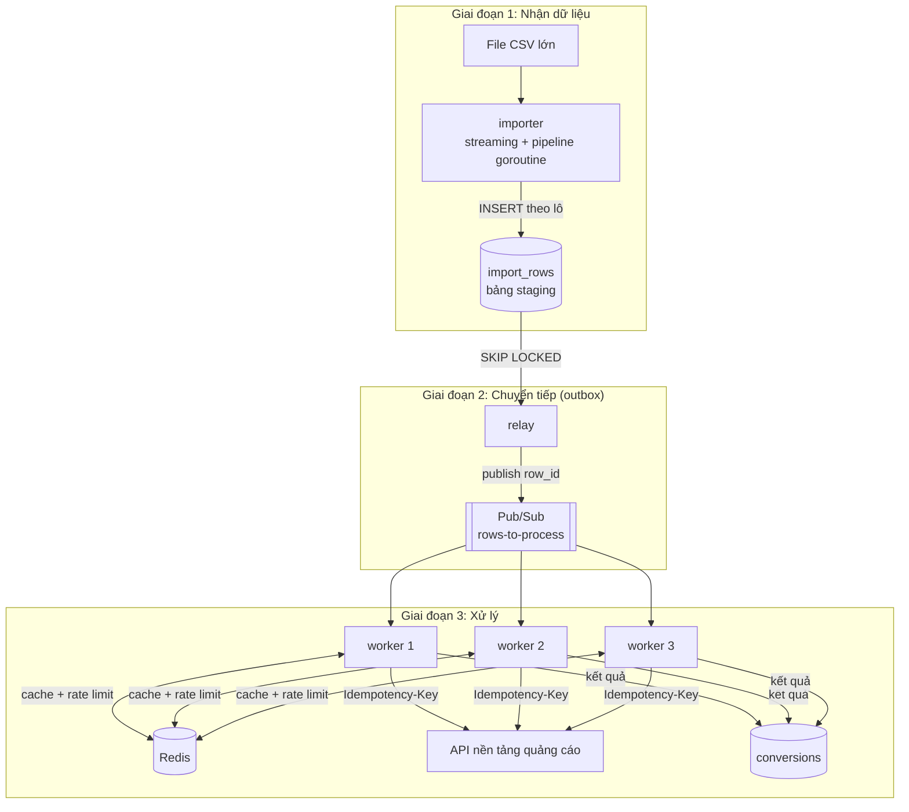
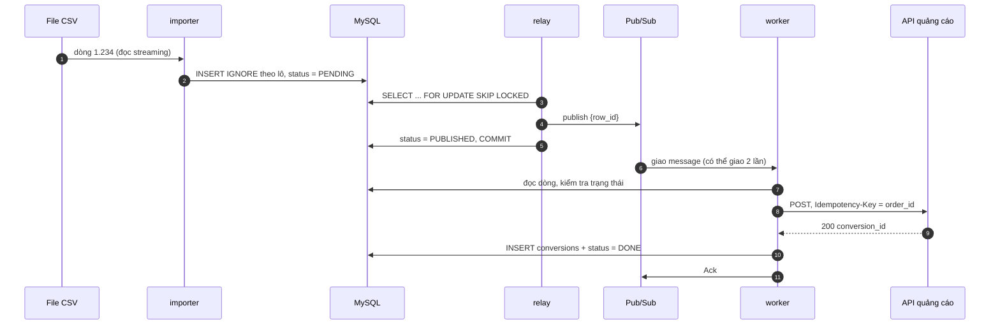
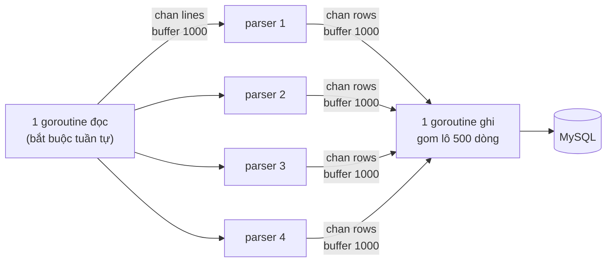
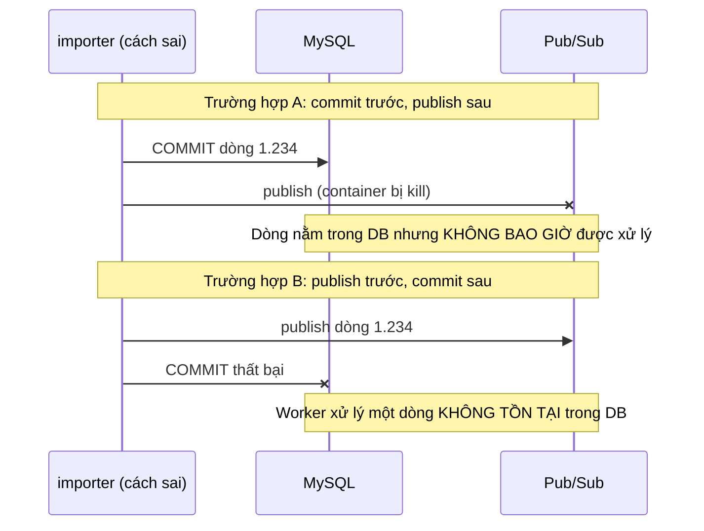
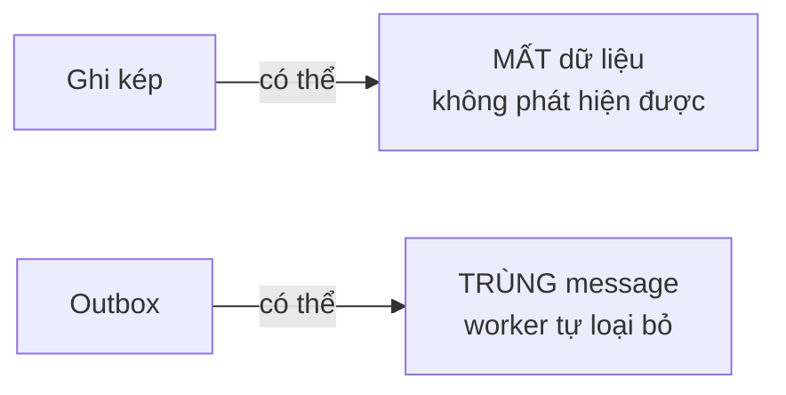
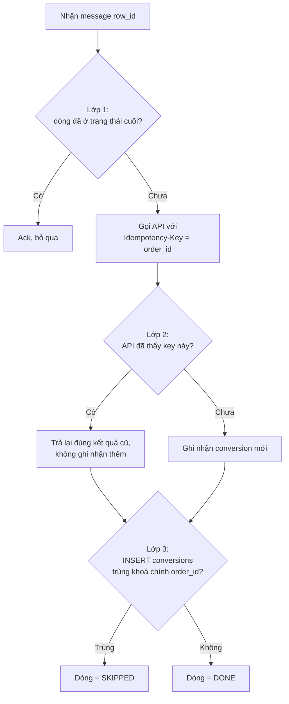
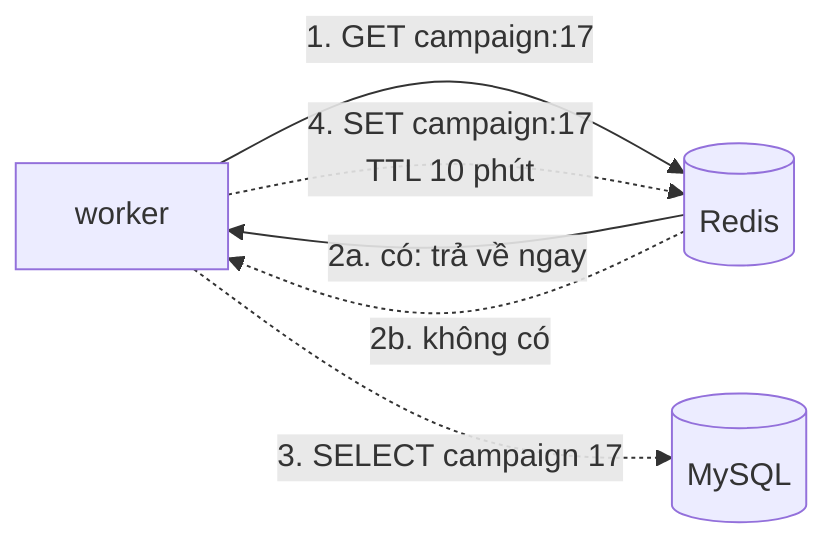
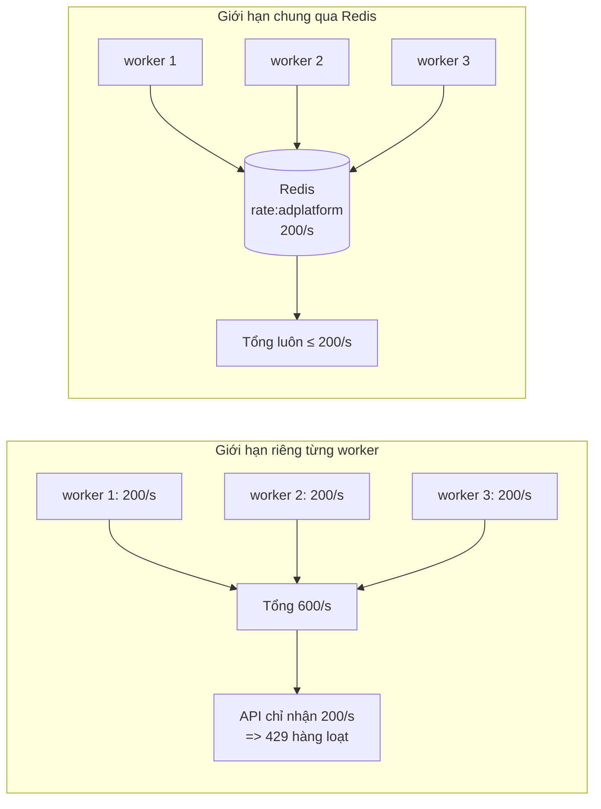
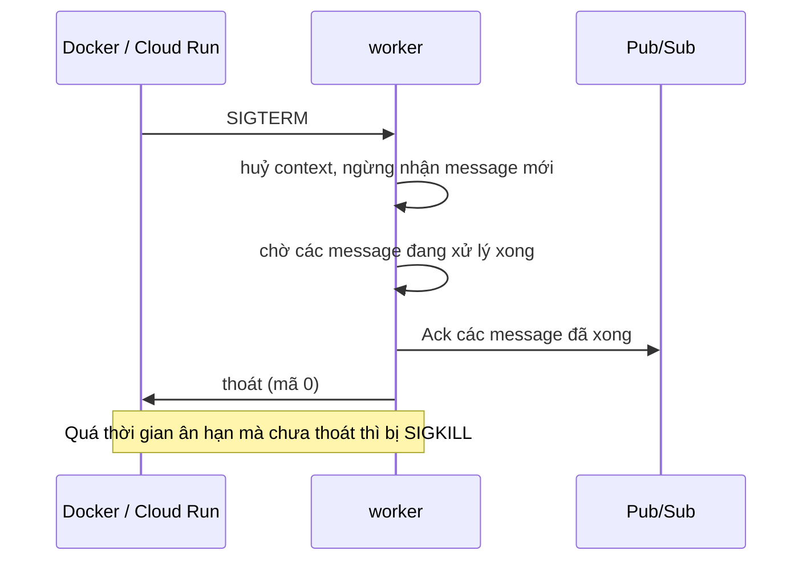
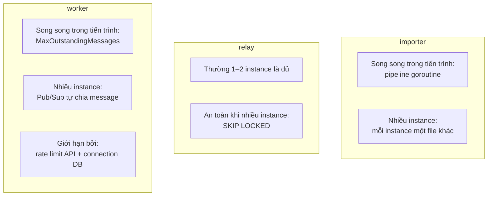

# Kiến trúc Conversion Pipeline: nhập môn backend cho mobile developer

Tài liệu này giải thích **vì sao** `conversion-pipeline` được thiết kế như trong tài liệu yêu cầu (`01-requirement-conversion-pipeline.md`). Mỗi quyết định được trình bày theo cùng một khung:

- **Làm gì:** quyết định cụ thể.
- **Vì sao:** vấn đề nó giải quyết.
- **Nếu không làm vậy:** chuyện gì xảy ra, thường là một sự cố có thật.
- **Liên hệ mobile:** khái niệm gần nhất mà bạn đã quen khi làm iOS hoặc Android.

---

## 1. Thay đổi tư duy: từ app sang server

Phần lớn khác biệt giữa mobile và backend không nằm ở ngôn ngữ, mà ở **giả định về môi trường**.

| Khía cạnh | App mobile | Backend |
| --- | --- | --- |
| Ai dùng | Một người, trên một máy | Hàng nghìn request cùng lúc, nhiều instance cùng chạy |
| Lỗi | Thỉnh thoảng; báo lỗi và cho người dùng thử lại | **Luôn xảy ra**: mạng chập chờn, container bị kill, DB khởi động lại. Phải tự phục hồi, không ai bấm "thử lại" |
| Chạy lại | Người dùng mở lại app | Hệ thống tự retry, và **mọi bước phải chạy lại được an toàn** |
| Dữ liệu sai | Ảnh hưởng một người, sửa bằng bản cập nhật | Ảnh hưởng mọi người, đã ghi vào DB hoặc đã gửi đi thì **không thu hồi được** |
| Bộ nhớ | Một màn hình, một danh sách | Một file vài GB, một bảng hàng chục triệu dòng |
| Hiệu năng | Mượt 60 khung hình/giây | Thông lượng (bao nhiêu dòng/giây) và độ trễ dưới tải |
| Đồng thời | Main thread và vài background task | Hàng trăm goroutine trên nhiều máy cùng sửa một bảng |

Ba câu hỏi một backend developer luôn tự đặt cho mỗi bước:

1. **Bước này chết giữa chừng thì sao?**
2. **Bước này chạy hai lần thì sao?**
3. **Có 10 bản của bước này cùng chạy thì sao?**

Mọi quyết định bên dưới là câu trả lời cho ba câu hỏi đó.

---

## 2. Toàn cảnh



Ba giai đoạn được **ngăn cách bằng nơi lưu trữ bền vững** (MySQL, Pub/Sub). Nhờ vậy giai đoạn nào chết cũng không kéo theo giai đoạn khác, và mỗi giai đoạn scale độc lập theo nút thắt của riêng nó.

### Hành trình của một dòng



---

## 3. Đọc file streaming, không đọc cả file

**Làm gì.** Importer đọc file từng dòng bằng `csv.Reader`. Bộ nhớ chỉ giữ vài nghìn dòng đang nằm trong các channel.

**Vì sao.** Kích thước file không do bạn quyết định. Hôm nay là 50 MB, tháng sau đối tác gửi 5 GB.

**Nếu không làm vậy.** `io.ReadAll` hay `os.ReadFile` đưa cả file vào RAM. Container có giới hạn 1 GB sẽ bị hệ điều hành kill (OOM) mà không kịp in log lỗi nào. Tệ hơn, nó chạy ổn trên máy dev với file mẫu nhỏ, rồi chết đúng lúc lên production.

```go
data, _ := io.ReadAll(f)   // SAI: cả file vào RAM
r := csv.NewReader(f)      // ĐÚNG: mỗi lần chỉ giữ một dòng
```

**Liên hệ mobile.** Giống `UITableView`/`RecyclerView` chỉ tạo cell cho phần đang hiển thị thay vì 100.000 cell, hay tải ảnh lớn bằng downsampling thay vì decode nguyên ảnh gốc.

---

## 4. Pipeline goroutine với buffered channel

**Làm gì.** Importer chia việc thành ba tầng chạy song song:



**Vì sao.**
- Đọc CSV phải tuần tự, vì không biết dòng thứ 1 triệu bắt đầu ở byte nào. Nhưng parse và validate thì độc lập giữa các dòng, nên chạy song song được.
- **Buffered channel tạo ra backpressure tự nhiên.** Nếu DB ghi chậm, channel `rows` đầy, parser bị chặn, rồi channel `lines` đầy, reader bị chặn. Toàn bộ pipeline tự chậm lại theo tầng chậm nhất, bộ nhớ không phình ra.
- Một tầng lỗi (ví dụ DB mất kết nối) thì các tầng khác phải dừng theo thay vì chạy tiếp vô ích. Bản đầu tiên làm việc này bằng tay với `sync.WaitGroup`, `context.WithCancel` và `sync.Once`; sau khi hiểu cơ chế mới chuyển sang `errgroup`, thư viện gói gọn đúng ba thứ đó.
- Số dòng `line_no` được gán ngay lúc đọc, nên các parser xong theo thứ tự nào cũng không làm sai dữ liệu.

**Nếu không làm vậy.**
- **Một goroutine làm hết:** an toàn nhưng CPU nhàn rỗi trong lúc chờ DB, chậm hơn nhiều lần.
- **Mỗi dòng một goroutine:** 1 triệu goroutine cùng muốn ghi DB, hết connection, bộ nhớ tăng vọt. Song song **không giới hạn** là một kiểu lỗi, không phải tối ưu.
- **Channel không buffer, hoặc buffer vô hạn (slice):** không buffer thì các tầng chờ nhau từng dòng một; vô hạn thì mất backpressure, tầng nhanh dồn dữ liệu vào RAM khi tầng sau chậm.

**Liên hệ mobile.** Giống `OperationQueue` với `maxConcurrentOperationCount` hoặc `TaskGroup` có giới hạn: bạn không tạo 10.000 request ảnh cùng lúc, mà giới hạn khoảng 4–6 request song song.

---

## 5. Ghi theo lô trong transaction

**Làm gì.** Gom 500 dòng thành một câu `INSERT ... VALUES (...), (...), ...`.

**Vì sao.** Mỗi câu SQL tốn một lượt đi về qua mạng (round-trip) và một lần commit ghi xuống đĩa. Gom lô giảm số lượt đó đi hàng trăm lần.

**Nếu không làm vậy.** 300.000 dòng là 300.000 round-trip và 300.000 lần commit. Ví dụ mỗi lần mất 2 ms thì đã là 10 phút chỉ để chờ, trong khi gom lô 500 dòng chỉ còn 600 câu lệnh.

Lô cũng không nên quá lớn: MySQL giới hạn tối đa 65.535 placeholder mỗi prepared statement, và một transaction quá lớn sẽ giữ khoá lâu, làm các truy vấn khác phải chờ.

**Liên hệ mobile.** Giống lưu Core Data hay Room theo từng đợt (`context.save()` sau một loạt thay đổi) thay vì save sau mỗi object.

---

## 6. Bảng staging và khoá duy nhất: import chạy lại được

**Làm gì.**
- Mỗi file thành một `import_job`, nhận diện bằng **SHA-256 của nội dung** (`UNIQUE`).
- Mỗi dòng có khoá duy nhất `(job_id, line_no)`, ghi bằng `INSERT IGNORE`.
- Lưu cả dòng sai với trạng thái `INVALID` và lý do.

**Vì sao.** Importer chắc chắn sẽ có lúc bị dừng giữa chừng: deploy bản mới, máy restart, ai đó nhấn Ctrl+C. Với khoá duy nhất, chạy lại chỉ cần đọc lại từ đầu; những dòng đã có sẽ bị bỏ qua.

**Nếu không làm vậy.**
- Không có khoá duy nhất: chạy lại là **nhân đôi dữ liệu**, rồi gửi trùng cho đối tác. Cách sửa duy nhất là xoá tay, và phải đoán xem dòng nào là bản gốc.
- Nhận diện job bằng tên file: hai file khác nội dung nhưng cùng tên `orders.csv` sẽ bị coi là một.
- Vứt bỏ dòng sai: không ai biết vì sao đơn hàng của mình không được ghi nhận, và đội hỗ trợ phải đi đọc log.

**Liên hệ mobile.** Giống dùng `id` từ server làm khoá chính trong DB local: đồng bộ lại bao nhiêu lần thì vẫn là "upsert", không phải "thêm mới".

---

## 7. Outbox: vì sao có `relay` thay vì importer publish luôn

Đây là quyết định quan trọng nhất của thiết kế.

**Làm gì.** Importer **chỉ ghi DB**. Một tiến trình riêng (`relay`) đọc các dòng `PENDING` và publish lên Pub/Sub.

**Vì sao: vấn đề ghi kép (dual write).** Khi một bước phải ghi vào **hai hệ thống** (MySQL và Pub/Sub), không có cách nào làm cả hai thành công hoặc thất bại cùng lúc. Máy có thể chết giữa hai lệnh.



Với outbox, chỉ có **một** hệ thống là nguồn sự thật: MySQL. Relay đọc những gì đã commit chắc chắn rồi mới publish. Nếu relay chết sau khi publish nhưng trước khi đánh dấu `PUBLISHED`, lô đó bị publish lại. Như vậy có thể **trùng, nhưng không bao giờ mất**, và chuyện trùng thì worker đã xử lý được (mục 10).



**Nếu không làm vậy.** Mất dữ liệu **âm thầm**: không lỗi, không log, chỉ là cuối tháng số conversion thấp hơn thực tế và không ai giải thích được vì sao.

**Liên hệ mobile.** Bạn đã gặp mẫu này: app offline-first lưu thao tác của người dùng vào DB local trước (hàng đợi "chờ đồng bộ"), rồi một tiến trình nền gửi lên server khi có mạng. Không ai gọi API trực tiếp từ nút bấm rồi mới lưu local, vì mất mạng giữa chừng là mất thao tác.

---

## 8. `SKIP LOCKED`: nhiều relay không giẫm chân nhau

**Làm gì.**
```sql
SELECT id FROM import_rows
WHERE status = 'PENDING'
ORDER BY id LIMIT 500
FOR UPDATE SKIP LOCKED;
```

**Vì sao.** `FOR UPDATE` khoá các dòng được chọn cho đến khi transaction kết thúc. `SKIP LOCKED` bảo relay thứ hai **bỏ qua** những dòng đang bị khoá và lấy 500 dòng tiếp theo.

**Nếu không làm vậy.**
- Không khoá: hai relay cùng đọc 500 dòng giống nhau, mọi message bị publish hai lần.
- Chỉ `FOR UPDATE`, không `SKIP LOCKED`: relay thứ hai đứng chờ relay thứ nhất xong rồi mới chạy, nên thêm instance cũng không nhanh hơn.

**Liên hệ mobile.** Giống `NSLock` hoặc `synchronized`, nhưng ở mức từng dòng dữ liệu, và có thêm lựa chọn "đang bận thì làm việc khác" thay vì đứng chờ.

---

## 9. Pub/Sub: giao ít nhất một lần, Ack và Nack

**Làm gì.** Relay và worker giao tiếp qua một hàng đợi message (Pub/Sub), không gọi trực tiếp nhau.

**Vì sao.**
- **Tách tốc độ:** importer ghi 10.000 dòng/giây nhưng API đích chỉ nhận 500/giây. Hàng đợi là nơi chứa phần chênh lệch.
- **Bền vững:** message nằm trong Pub/Sub cho đến khi được Ack. Worker chết thì message được giao cho worker khác.
- **Scale tự nhiên:** mọi worker cùng nghe một subscription, Pub/Sub tự chia message (mô hình competing consumers).

**Quy tắc quan trọng nhất: giao ít nhất một lần (at-least-once).** Một message **có thể đến hai lần hoặc hơn**: worker xử lý xong nhưng chết trước khi Ack, Ack bị mất trên đường, quá hạn Ack nên bị giao lại.

| Worker làm | Pub/Sub làm |
| --- | --- |
| `Ack()` | Xoá message, không giao lại |
| `Nack()` | Giao lại sớm, có thể cho worker khác |
| Không làm gì, quá ack deadline | Coi như thất bại, giao lại |

**Nếu không làm vậy (gọi HTTP trực tiếp từ relay sang worker).** Worker quá tải hoặc đang deploy là relay phải tự lưu, tự retry, tự phân tải. Tức là bạn tự viết lại một hàng đợi, và gần như chắc chắn viết không tốt bằng.

**Liên hệ mobile.** Push notification cũng là at-least-once: app đôi khi nhận một thông báo hai lần, nên phải dựa vào ID để không hiển thị trùng.

### Message chỉ chứa `row_id`

Relay publish `{"row_id": 123}` chứ không gửi cả nội dung dòng. Worker tự đọc dòng từ DB. Cách này gọi là **claim check**: message nhỏ, và worker luôn thấy **trạng thái mới nhất**. Nếu dòng đã `DONE` do một lần giao trước, worker biết ngay để bỏ qua.

---

## 10. Worker idempotent: xử lý hai lần cũng như một lần

**Idempotent** nghĩa là làm một việc nhiều lần cho ra kết quả giống làm một lần. Vì Pub/Sub có thể giao trùng, đây là yêu cầu bắt buộc chứ không phải tối ưu.

**Làm gì: ba lớp bảo vệ.**



1. **Kiểm tra trạng thái trước khi làm.** Nhanh, chặn phần lớn trường hợp trùng.
2. **Idempotency-Key gửi sang API.** Hai worker cùng lúc gửi một đơn hàng, phía API chỉ ghi nhận một lần. Đây là cách các API thanh toán phổ biến chống trừ tiền hai lần. WireMock trong demo không ghi nhớ key, nên lớp này chỉ có tác dụng với API thật. Worker vẫn phải gửi header, vì đó là hợp đồng với API thật, và WireMock từ chối request thiếu header.
3. **Khoá chính `order_id` trong `conversions`.** Chốt chặn cuối cùng ở DB. Hai dòng trùng `order_id` trong file vượt qua được lớp 1 cùng lúc thì vẫn chỉ một dòng ghi thành công.

**Vì sao cần cả ba.** Lớp 1 có khe hở thời gian: hai worker có thể cùng đọc thấy "chưa xong" trước khi bên kia kịp ghi. Lớp 2 và 3 không phụ thuộc thời gian, nên luôn đúng.

**Một chi tiết tinh tế.** Worker xử lý dòng ở trạng thái `PENDING` **hoặc** `PUBLISHED`. Lý do: relay publish xong rồi mới commit `PUBLISHED`, nên worker có thể nhận message **trước** khi relay commit, và lúc đó vẫn đọc thấy `PENDING`. Nếu worker chỉ nhận `PUBLISHED`, dòng đó sẽ bị bỏ qua oan. Kiểu lỗi phụ thuộc thời gian này rất khó tái hiện khi debug, nên phải nghĩ ra từ lúc thiết kế.

**Nếu không làm vậy.** Đối tác nhận một đơn hàng hai lần, doanh thu báo cáo bị thổi phồng. Với chi lương hay thanh toán, đó là chuyển tiền hai lần.

**Liên hệ mobile.** Người dùng bấm nút "Thanh toán" hai lần vì mạng chậm. App tốt sẽ gửi cùng một mã request cho cả hai lần bấm, để server chỉ trừ tiền một lần.

---

## 11. Phân loại lỗi: lỗi nào retry, lỗi nào không

**Làm gì.**

| Lỗi | Ví dụ | Bản chất | Xử lý |
| --- | --- | --- | --- |
| Dữ liệu sai | Thiếu `click_id`, `amount = abc` | Vĩnh viễn, phát hiện được trước | `INVALID` ngay ở importer, không gửi đi |
| Nghiệp vụ không hợp lệ | Campaign đã dừng | Vĩnh viễn | `FAILED`, không gọi API |
| Bị từ chối | `400 click_expired` | Vĩnh viễn | `FAILED`, Ack |
| Quá tải | `429` | Tạm thời | Retry có backoff |
| Lỗi phía server | `500`, `503`, timeout, mất mạng | Tạm thời | Retry có backoff |
| Thử quá nhiều lần | 5 lần vẫn `500` | Coi như vĩnh viễn | `FAILED`, Ack |

**Backoff tăng dần:** lần thử thứ n chờ `min(500ms × 2^n, 10s)`, tức 1s, 2s, 4s, 8s, 10s.

**Nếu không làm vậy.**
- **Retry mọi lỗi:** một dòng `400` bị gửi lại mãi mãi, chiếm tài nguyên mà không bao giờ thành công. Khi có hàng nghìn dòng như vậy, hàng đợi tắc nghẽn.
- **Không retry lỗi nào:** một lần API chập chờn 2 giây làm hàng trăm đơn hàng hợp lệ bị đánh dấu `FAILED`.
- **Retry ngay lập tức, không chờ:** API đang quá tải lại bị dội thêm request, càng khó hồi phục. Hiện tượng này có tên là *retry storm*.
- **Không giới hạn số lần thử:** một message lỗi vĩnh viễn bị giao lại vô tận ("poison message"). Production thường chuyển những message này sang **dead-letter topic**; demo thay bằng đếm `attempts` trong DB.

**Liên hệ mobile.** Bạn không tự động thử lại khi server trả `401` hay `404`, nhưng thử lại khi mất mạng. Thư viện networking tốt cũng retry có backoff chứ không thử liên tục.

---

## 12. Redis việc 1: cache-aside cho campaign

**Làm gì.** Trước khi gửi một dòng, worker cần biết campaign của nó còn chạy không:



**Vì sao.** File 300.000 dòng thường chỉ thuộc vài trăm campaign. Không có cache, MySQL nhận 300.000 truy vấn giống hệt nhau, cạnh tranh tài nguyên với chính các lệnh ghi kết quả. Có cache thì chỉ vài trăm truy vấn đầu tiên chạm DB.

**Vì sao Redis mà không phải cache trong bộ nhớ của từng worker.** Có 3 worker. Khi một campaign bị tạm dừng, chỉ cần xoá **một** key `campaign:17` trong Redis là cả 3 worker cùng thấy ngay. Cache riêng trong từng worker thì mỗi worker giữ dữ liệu cũ cho đến khi hết TTL, và không có cách xoá tập trung.

**Ba chi tiết của một cache tốt.**
- **Cache cả kết quả "không tồn tại".** Campaign 215 không có trong DB. Nếu không cache điều đó, mọi dòng thuộc campaign 215 đều đánh vào MySQL. Hiện tượng này gọi là *cache penetration*.
- **TTL có độ lệch ngẫu nhiên (jitter).** Nếu mọi key cùng hết hạn một lúc, tất cả worker cùng đổ về DB.
- **Redis lỗi thì đọc DB.** Cache là để nhanh hơn, không phải để đúng hơn. Redis chết thì hệ thống chậm đi chứ không được dừng lại.

**Nếu không làm vậy.** DB trở thành nút thắt, và tăng số worker chỉ làm DB quá tải nhanh hơn.

**Liên hệ mobile.** Giống `NSCache` hay cache ảnh với hạn sử dụng, nhưng **dùng chung** cho nhiều máy, giống như nhiều thiết bị cùng đọc một CDN.

---

## 13. Redis việc 2: rate limiter dùng chung

**Làm gì.** Trước mỗi lần gọi API, worker xin một "lượt" từ Redis. Key `rate:adplatform` giới hạn 200 lượt/giây **cho toàn bộ hệ thống**.

**Vì sao.** Giới hạn tốc độ của API đích tính cho **cả hệ thống của bạn**, không phải cho từng worker.



**Nếu không làm vậy.**
- Mỗi khi scale thêm worker, số lỗi `429` tăng theo. Thêm máy lại làm hệ thống chậm hơn, vì phần lớn thời gian dành cho retry.
- Chia đều thủ công (3 worker × khoảng 67/s) chạy được, nhưng phải sửa cấu hình mỗi khi số worker thay đổi. Hệ thống tự động scale thì không làm vậy được.
- Một số API sẽ **khoá tài khoản tạm thời** nếu liên tục vượt giới hạn.

**Kiểm chứng trong demo.** WireMock không tự giới hạn tốc độ nên không trả `429`. Vì vậy mỗi worker tăng một bộ đếm `calls:{giây hiện tại}` trong Redis trước mỗi lần gọi. Bộ đếm này cộng dồn lượt gọi của **mọi** worker trong cùng một giây. Bật rate limiter thì đỉnh không vượt quá 200; tắt đi với 3 worker thì đỉnh vượt xa 200. Đây cũng là một ví dụ thực tế về atomic counter dùng chung giữa nhiều máy: `INCR` của Redis là thao tác nguyên tử, nên không bị mất lượt đếm khi nhiều worker cùng tăng.

**Liên hệ mobile.** Giống debounce hay throttle khi người dùng gõ vào ô tìm kiếm, nhưng phối hợp giữa nhiều máy thay vì trong một app.

---

## 14. Vì sao **không** dùng Redis để chống trùng

**Làm gì.** Chống trùng được giao cho MySQL (khoá duy nhất, `SKIP LOCKED`), không dùng Redis lock.

**Vì sao.** Dữ liệu cần đúng nằm trong MySQL. Khoá duy nhất được kiểm tra **trong cùng transaction** với lệnh ghi, nên không có khe hở. Redis lock nằm ở một hệ thống khác, có thể hết hạn hoặc mất khi Redis restart, và lại dẫn về bài toán ghi kép ở mục 7.

**Nếu thêm Redis lock vào.** Thêm một thành phần có thể hỏng, thêm code, nhưng không thêm sự đảm bảo nào mà MySQL chưa có.

Nguyên tắc rút ra: **mỗi công nghệ phải giải một vấn đề cụ thể.** Câu "em dùng Redis vì hệ thống nào cũng có Redis" là câu trả lời yếu khi phỏng vấn. Câu "em dùng Redis cho cache và rate limit vì hai việc đó cần trạng thái dùng chung giữa nhiều worker, còn chống trùng em để MySQL lo vì nó nằm trong transaction" là câu trả lời mạnh.

---

## 15. Graceful shutdown

**Làm gì.** Mọi tiến trình bắt tín hiệu `SIGTERM`, ngừng nhận việc mới, làm nốt việc đang dở, rồi mới thoát.



**Vì sao.** Mỗi lần deploy, scale xuống hay khởi động lại máy, nền tảng đều gửi `SIGTERM` trước, chờ một khoảng ngắn, rồi mới kill hẳn.

**Nếu không làm vậy.** Mỗi lần deploy là một lần cắt ngang hàng trăm việc đang làm. Nhờ idempotent nên dữ liệu không hỏng, nhưng những việc đó phải làm lại từ đầu, và nếu API đã ghi nhận mà DB chưa kịp ghi thì phải trông vào lớp bảo vệ thứ 2 và 3 ở mục 10.

**Liên hệ mobile.** Giống `applicationWillTerminate` hay `onStop`: lưu trạng thái trước khi hệ điều hành đóng app. Khác ở chỗ backend nhận tín hiệu này **mỗi lần deploy**, tức là nhiều lần mỗi ngày.

---

## 16. Giới hạn connection: tài nguyên dùng chung có hạn

**Làm gì.** Mỗi tiến trình đặt `MYSQL_MAX_OPEN_CONNS` (mặc định 10).

**Vì sao.** `*sql.DB` của Go là một pool connection. MySQL cũng có giới hạn tổng số connection, mặc định `max_connections` là 151.

**Nếu không làm vậy.** Ví dụ 10 worker, mỗi worker mở tới 20 connection, cộng relay và importer là hơn 200 > 151. Lỗi `Too many connections` xuất hiện **chỉ khi scale lên**, không bao giờ xuất hiện khi test với 1 worker trên máy dev.

Công thức cần nhớ: **(số instance × MaxOpenConns của từng loại) < max_connections**, và chừa chỗ cho người vận hành kết nối vào kiểm tra.

**Liên hệ mobile.** Giống `URLSession` giới hạn số kết nối tới một host (`httpMaximumConnectionsPerHost`), nhưng ở đây giới hạn tính cho mọi máy cộng lại.

---

## 17. Scale: mỗi thành phần một cách



| Thành phần | Nút thắt | Scale bằng cách |
| --- | --- | --- |
| importer | Tốc độ ghi MySQL | Thêm parser, tăng kích thước lô; nhiều file thì nhiều instance |
| relay | Hiếm khi | Thêm instance nếu cần |
| worker | API đích và DB | Thêm instance, nhưng không vượt quá rate limit và connection |

Một file khổng lồ không chia cho nhiều importer được, vì CSV phải đọc tuần tự. Thực tế thường để **phía tạo file chia nhỏ** thành nhiều file.

---

## 18. Demo này bỏ qua gì so với production

Biết mình đang **cố ý** bỏ qua điều gì cũng quan trọng như biết mình làm gì.

| Demo | Production thật |
| --- | --- |
| Đọc file local | File trên GCS/S3; thông báo "file mới" tự động qua Pub/Sub |
| Đếm `attempts` trong DB | Dead-letter topic và quy trình xử lý lại thủ công |
| Backoff trong worker rồi Nack | Retry policy cấu hình trên subscription |
| Schema nạp một lần | Công cụ migration có phiên bản (`golang-migrate`, `goose`) |
| Log ra stdout | Log tập trung, metric (Prometheus), cảnh báo khi hàng đợi tồn đọng |
| Mật khẩu trong `compose.yaml` | Secret Manager, IAM, kết nối mã hoá |
| Một MySQL | Bản sao đọc, sao lưu, kế hoạch khôi phục |
| WireMock trả response cố định, không lưu trạng thái | API thật tự giới hạn tốc độ (trả 429), ghi nhớ Idempotency-Key, có lỗi tạm thời rồi tự hồi phục, có phiên bản và hợp đồng thay đổi theo thời gian |
| Chạy tay bằng `go` và `docker compose` | CI/CD, môi trường staging, deploy từng phần |

---

## 19. Bảng đối chiếu nhanh: mobile và backend

| Khái niệm mobile | Tương đương backend trong dự án này |
| --- | --- |
| Hàng đợi đồng bộ offline-first | Outbox và relay |
| Mã request chống bấm nút hai lần | Idempotency-Key, khoá duy nhất |
| `OperationQueue` có giới hạn | Worker pool, `errgroup.SetLimit`, `MaxOutstandingMessages` |
| Cell reuse, downsampling ảnh | Đọc streaming |
| `NSCache` / cache ảnh có hạn | Redis cache-aside có TTL |
| Debounce / throttle | Rate limiter dùng chung |
| Push notification có thể trùng | Pub/Sub giao ít nhất một lần |
| Retry khi mất mạng, không retry khi `401` | Phân loại lỗi tạm thời và vĩnh viễn |
| `applicationWillTerminate` | Graceful shutdown khi nhận `SIGTERM` |
| Main thread và background queue | Goroutine và channel |

---

## 20. Thuật ngữ

| Thuật ngữ | Nghĩa |
| --- | --- |
| **At-least-once** | Một message được đảm bảo giao ít nhất một lần, nên có thể bị giao trùng |
| **Backoff** | Chờ một khoảng tăng dần giữa các lần thử lại |
| **Backpressure** | Cơ chế để tầng chậm làm tầng nhanh tự chậm lại, tránh dồn dữ liệu |
| **Cache-aside** | Đọc cache trước; không có thì đọc DB rồi ghi vào cache |
| **Claim check** | Message chỉ mang ID; bên nhận tự lấy dữ liệu đầy đủ từ nơi lưu trữ |
| **Competing consumers** | Nhiều worker cùng nghe một hàng đợi, mỗi message chỉ một worker nhận |
| **Dead-letter topic** | Nơi chứa message thất bại quá số lần cho phép, để xem xét sau |
| **Dual write** | Ghi vào hai hệ thống trong một bước; không thể đảm bảo cả hai cùng thành công |
| **Graceful shutdown** | Tắt có trật tự: ngừng nhận việc mới, làm nốt việc đang dở |
| **Idempotent** | Làm nhiều lần cho kết quả như làm một lần |
| **Outbox** | Ghi sự kiện vào DB cùng dữ liệu, một tiến trình khác đọc ra và publish |
| **Poison message** | Message luôn làm worker thất bại, nếu không giới hạn sẽ được giao lại mãi |
| **Rate limiting** | Giới hạn số thao tác trong một đơn vị thời gian |
| **Staging table** | Bảng trung gian chứa dữ liệu thô trước khi xử lý |
| **Thundering herd** | Rất nhiều tiến trình cùng đổ về một tài nguyên cùng lúc |

---

## 21. Đọc tiếp

- [Go by Example](https://gobyexample.com/): goroutines, channels, worker pools, rate limiting, context.
- [A Tour of Go – Concurrency](https://go.dev/tour/concurrency/1)
- [`errgroup`](https://pkg.go.dev/golang.org/x/sync/errgroup): đọc cả mã nguồn, chỉ khoảng 150 dòng.
- [`singleflight`](https://pkg.go.dev/golang.org/x/sync/singleflight): giải pháp khác cho cache stampede.
- [Cloud Pub/Sub – Exactly-once and at-least-once delivery](https://cloud.google.com/pubsub/docs/exactly-once-delivery)
- [MySQL – Locking Reads (`SKIP LOCKED`)](https://dev.mysql.com/doc/refman/8.0/en/innodb-locking-reads.html)
- [`go-redis/redis_rate`](https://github.com/go-redis/redis_rate)
