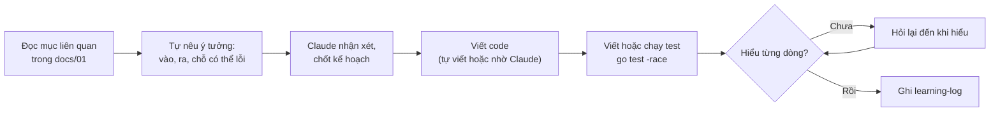
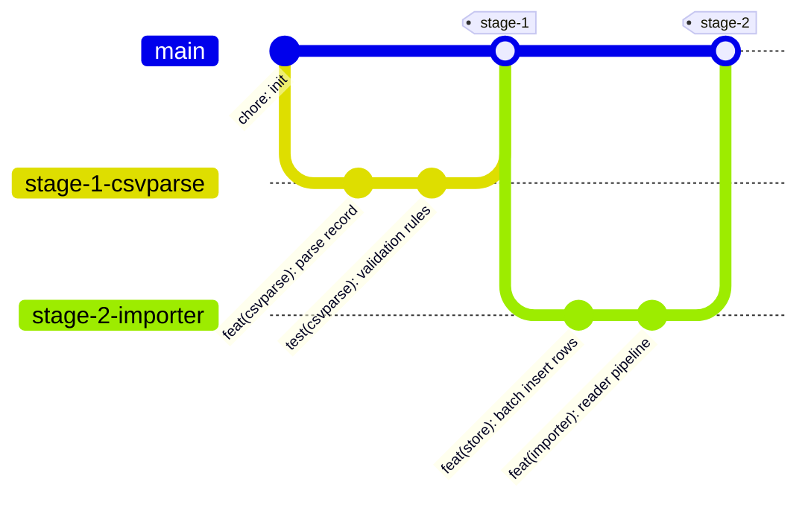

# Quy ước code: conversion-pipeline

Áp dụng cho mọi code Go trong repo, do người hay do Claude Code viết. Mỗi quy tắc có lý do đi kèm, chi tiết hơn ở `docs/02`.

## 0. Quy trình làm một function



Một function chỉ coi là xong khi **người học giải thích được từng dòng** và test chạy qua.

## 1. Chung

- Go 1.22 trở lên. Code phải qua `gofmt` và `go vet ./...`.
- Cấu trúc thư mục theo mục 8 của `docs/01`. Không tạo package mới khi chưa thống nhất.
- Đặt tên kiểu Go: `MixedCaps`, tên package viết thường không gạch dưới, receiver ngắn (`func (s *Store) ...`).
- Chỉ export (viết hoa chữ đầu) những gì package khác thật sự dùng.
- Function ngắn, làm một việc. Dài quá khoảng 40 dòng thì cân nhắc tách.
- Comment giải thích **vì sao**, không lặp lại code làm gì.
- **Code chân phương:** chỉ viết thứ đang cần, không abstraction "để sau này" (quy tắc đầy đủ ở `CLAUDE.md`, mục "Code chân phương"). Ví dụ với cùng một yêu cầu "parse một dòng CSV":

  ```go
  // Dư thừa: interface chỉ có một cài đặt, functional options không ai dùng,
  // constructor không cần thiết. Người đọc phải đi qua 4 khái niệm mới tới logic.
  type Parser interface {
  	Parse(record []string) (Order, error)
  }

  type ParserOption func(*csvParser)

  func WithStrictMode(strict bool) ParserOption {
  	return func(p *csvParser) { p.strict = strict }
  }

  type csvParser struct{ strict bool }

  func NewParser(opts ...ParserOption) Parser {
  	p := &csvParser{}
  	for _, opt := range opts {
  		opt(p)
  	}
  	return p
  }

  func (p *csvParser) Parse(record []string) (Order, error) { /* ... */ }
  ```

  ```go
  // Chân phương: một hàm, đúng việc docs/01 mục 4.1 yêu cầu.
  func Parse(record []string) (Order, error) { /* ... */ }
  ```

  Khi thật sự có nhu cầu thứ hai (ví dụ một định dạng file khác), lúc đó mới tách interface.

## 2. Xử lý lỗi

- Lỗi bình thường thì **trả về**, không `panic`. `panic` chỉ được phép trong `main` khi cấu hình khởi động sai.
- Bọc lỗi kèm ngữ cảnh bằng `%w`. Thông điệp viết thường, không dấu chấm cuối:
  ```go
  return fmt.Errorf("insert batch job=%d: %w", jobID, err)
  ```
- Package `store` định nghĩa lỗi sentinel để tầng trên không phải biết MySQL:
  ```go
  var (
  	ErrNotFound  = errors.New("not found")
  	ErrDuplicate = errors.New("duplicate")
  )

  // Chuyển lỗi MySQL 1062 thành ErrDuplicate ngay trong store
  var me *mysql.MySQLError
  if errors.As(err, &me) && me.Number == 1062 {
  	return ErrDuplicate
  }
  ```
- Kiểm tra lỗi bằng `errors.Is` hoặc `errors.As`, không so sánh chuỗi.
- **Log một lần ở nơi xử lý lỗi**, không vừa log vừa trả lỗi lên tầng trên.

## 3. Context

- `ctx context.Context` luôn là tham số đầu tiên của function có I/O hoặc chạy lâu.
- Truyền `ctx` xuống mọi lời gọi: `QueryContext`, `ExecContext`, `BeginTx`, `http.NewRequestWithContext`, các hàm Redis và Pub/Sub.
- Chỉ tạo `context.Background()` trong `main`, ngay sau đó bọc bằng `signal.NotifyContext(ctx, os.Interrupt, syscall.SIGTERM)`.
- Không lưu `ctx` trong struct. Mỗi lần tạo context có timeout hoặc cancel thì `defer cancel()` ngay dòng sau.

## 4. Đa luồng

| Quy tắc | Vì sao |
| --- | --- |
| Mỗi goroutine có **người sở hữu** và **đường thoát** rõ ràng (`ctx.Done()` hoặc channel bị đóng) | Không có đường thoát là goroutine leak |
| Chỉ **bên gửi** đóng channel | Gửi vào channel đã đóng gây panic |
| Mọi lệnh gửi vào channel có thể bị chặn đều đặt trong `select` cùng `<-ctx.Done()` | Để huỷ được khi tầng sau đã dừng |
| Số goroutine luôn **có giới hạn**, không tạo một goroutine cho mỗi dòng dữ liệu | Tránh cạn connection DB và bộ nhớ |
| Kích thước buffer của channel có lý do, ghi trong comment | Buffer quá nhỏ làm các tầng chờ nhau; buffer vô hạn làm mất backpressure |
| Bộ đếm dùng chung dùng `sync/atomic`; map dùng chung bảo vệ bằng `sync.Mutex` | Tránh data race |
| Handler của Pub/Sub `Receive` được coi là **chạy song song** | Thư viện gọi handler trên nhiều goroutine |
| Luôn chạy test với `-race` | Data race thường không lộ khi chạy thử bằng tay |

- Chỉ dùng công cụ có sẵn: `go`, `chan`, `select`, `sync.WaitGroup`, `sync.Mutex`, `sync.Once`, `sync/atomic`, `context`, `time.Ticker`.
- `golang.org/x/sync/errgroup` chỉ được dùng **sau khi** đã có bản viết tay chạy đúng (xem `CLAUDE.md`).

## 5. Database (`database/sql`)

- Mỗi tiến trình chỉ có **một** `*sql.DB`, tạo trong `main`, cấu hình pool từ biến môi trường:
  ```go
  db.SetMaxOpenConns(cfg.MySQLMaxOpenConns)
  db.SetMaxIdleConns(cfg.MySQLMaxOpenConns)
  db.SetConnMaxLifetime(5 * time.Minute)
  ```
- Mọi câu SQL nằm trong `internal/store`. Package khác gọi method của `Store`, không viết SQL.
- Chỉ dùng placeholder `?`. **Không bao giờ** ghép chuỗi giá trị vào câu SQL.
- Đọc nhiều dòng: `defer rows.Close()` và kiểm tra `rows.Err()` sau vòng lặp.
- Đọc một dòng không có kết quả: `sql.ErrNoRows` được chuyển thành `store.ErrNotFound`.
- Mẫu transaction:
  ```go
  tx, err := s.db.BeginTx(ctx, nil)
  if err != nil {
  	return fmt.Errorf("begin tx: %w", err)
  }
  defer tx.Rollback() // no-op after a successful Commit

  // ... các câu lệnh dùng tx.ExecContext / tx.QueryContext ...

  return tx.Commit()
  ```
- Giữ transaction **ngắn**: không đọc file hay gọi HTTP bên trong transaction. Ngoại lệ duy nhất là relay publish Pub/Sub trong lúc giữ khoá `SKIP LOCKED`, xem `docs/02` mục 7–8.
- Thời gian lưu theo UTC. DSN có `parseTime=true`.

## 6. HTTP client

- Một `http.Client` dùng chung, luôn có `Timeout` (5 giây). Không dùng `http.DefaultClient`.
- Luôn `defer resp.Body.Close()`, kể cả khi status không phải 2xx.
- Phân loại theo status code đúng như `docs/01` mục 6.3 (WRK-7 đến WRK-9).

## 7. Log

- Dùng `log/slog` với `slog.NewJSONHandler(os.Stdout, nil)`. Không dùng `fmt.Println` trong service.
- Key viết dạng snake_case và thống nhất: `job_id`, `row_id`, `order_id`, `attempt`, `status`, `error`.
  ```go
  logger.Info("row processed", "job_id", jobID, "row_id", rowID, "order_id", orderID, "status", "DONE")
  ```
- `Error` cho lỗi cần người xem, `Warn` cho lỗi tạm thời sẽ retry, `Info` cho mốc quan trọng. Không log từng dòng ở mức `Info` trong importer.

## 8. Cấu hình

- Toàn bộ đọc từ biến môi trường trong `internal/config`, kèm giá trị mặc định ở mục 7 của `docs/01`.
- Kiểm tra và parse (số, `time.Duration`) ngay lúc khởi động. Sai thì dừng chương trình với thông báo rõ ràng.
- Không hard-code địa chỉ, mật khẩu hay con số cấu hình trong code.

## 9. Test

- Test table-driven, mỗi trường hợp chạy trong `t.Run`:
  ```go
  func TestParse(t *testing.T) {
  	tests := []struct {
  		name    string
  		record  []string
  		wantErr string
  	}{
  		{"valid", []string{"A1", "clk_1", "17", "1000", "2026-11-13T19:20:00+07:00"}, ""},
  		{"missing click_id", []string{"A1", "", "17", "1000", "2026-11-13T19:20:00+07:00"}, "missing click_id"},
  	}
  	for _, tt := range tests {
  		t.Run(tt.name, func(t *testing.T) {
  			_, err := Parse(tt.record)
  			if tt.wantErr == "" && err != nil {
  				t.Fatalf("unexpected error: %v", err)
  			}
  			if tt.wantErr != "" && (err == nil || err.Error() != tt.wantErr) {
  				t.Fatalf("want error %q, got %v", tt.wantErr, err)
  			}
  		})
  	}
  }
  ```
- Unit test không cần MySQL, Redis hay mạng. Logic cần test mà phụ thuộc bên ngoài thì nhận vào một **interface nhỏ khai báo ở phía dùng**, để test truyền bản giả.
- Bắt buộc có test cho `csvparse` (mọi luật ở mục 4.1 của `docs/01`) và cho hàm phân loại response HTTP của worker.

## 10. Dependency được phép

| Mục đích | Thư viện |
| --- | --- |
| Driver MySQL | `github.com/go-sql-driver/mysql` |
| Redis | `github.com/redis/go-redis/v9` |
| Rate limiter trên Redis | `github.com/go-redis/redis_rate/v10` |
| Pub/Sub | `cloud.google.com/go/pubsub` |
| Huỷ theo nhóm goroutine (sau bản viết tay) | `golang.org/x/sync/errgroup` |

Mọi thứ khác, kể cả ORM, framework web, thư viện cấu hình hay thư viện log, đều phải hỏi trước.

## 11. Checklist trước khi coi một function là xong

- [ ] `gofmt -l .` không liệt kê file nào; `go vet ./...` sạch.
- [ ] Mọi lỗi đều được xử lý hoặc trả về có ngữ cảnh.
- [ ] Mọi I/O nhận `ctx`; mọi goroutine có đường thoát.
- [ ] Không có SQL ngoài `internal/store`; không ghép chuỗi giá trị vào SQL.
- [ ] Không có code dư thừa: không tham số, tuỳ chọn, interface hay function nào chưa có chỗ dùng.
- [ ] Có test, hoặc ghi rõ vì sao chưa có; `go test -race` chạy qua.
- [ ] Người học giải thích được từng dòng.
- [ ] Đã commit theo quy ước ở mục 12.

## 12. Git

Repo dùng Git ngay từ ngày đầu, kể cả khi chỉ làm trên máy. Lịch sử commit cũng là bằng chứng về quá trình học khi đưa repo lên GitHub.

### 12.1. Khởi tạo

```bash
cd conversion-pipeline
git init -b main
go mod init github.com/<github-user>/conversion-pipeline
git add .
git commit -m "chore: init project with docs and Claude Code config"
```

Đặt module path theo **đúng đường dẫn repo GitHub sau này** ngay từ đầu. Đổi module path về sau phải sửa mọi dòng `import` trong dự án.

### 12.2. Branch theo giai đoạn



- Mỗi giai đoạn trong lộ trình (`CLAUDE.md`) là một branch: `stage-0-infra`, `stage-1-csvparse`, `stage-2-importer`, `stage-3-relay`, `stage-4-worker`, `stage-5-redis`, `stage-6-docker`.
- Giai đoạn xong khi các tiêu chí nghiệm thu liên quan ở `docs/01` mục 11 đạt. Khi đó merge vào `main` và gắn tag:
  ```bash
  git switch main
  git merge --no-ff stage-1-csvparse
  git tag stage-1
  ```
- `main` luôn build được và test luôn qua.

### 12.3. Commit

- **Commit nhỏ:** một function cùng test của nó là một commit. Mỗi commit phải build được (`go build ./...`).
- **Trước khi commit:** `gofmt -l .` không liệt kê file nào, `go vet ./...` sạch, `go test -race ./...` qua.
- **Message theo Conventional Commits**, viết tiếng Anh, scope là tên package hoặc chương trình:

| Loại | Dùng khi | Ví dụ |
| --- | --- | --- |
| `feat` | Thêm tính năng | `feat(importer): stream csv through parser pipeline` |
| `fix` | Sửa lỗi | `fix(worker): ack message when row already done` |
| `test` | Thêm hoặc sửa test | `test(csvparse): cover invalid amount and time` |
| `refactor` | Đổi cấu trúc, không đổi hành vi | `refactor(importer): replace manual cancel with errgroup` |
| `docs` | Tài liệu | `docs: add report output to readme` |
| `chore` | Cấu hình, dependency, công cụ | `chore: add redis to compose` |

- Commit thay `WaitGroup` viết tay bằng `errgroup` nên là một commit `refactor` riêng, để lịch sử cho thấy rõ bước chuyển này.

### 12.4. Không được commit

- File dữ liệu sinh ra (`data/`), binary, file coverage.
- File cá nhân của Claude Code: `CLAUDE.local.md`, `.claude/settings.local.json`.
- File `.env` hay bất kỳ mật khẩu, key thật nào. Mật khẩu trong `compose.yaml` chỉ là mật khẩu demo local.

Tất cả đã có sẵn trong `.gitignore`.

### 12.5. Đưa lên GitHub (khi sẵn sàng)

```bash
# Cách 1: dùng GitHub CLI
gh repo create conversion-pipeline --private --source=. --remote=origin --push

# Cách 2: tạo repo trống trên github.com rồi
git remote add origin git@github.com:<github-user>/conversion-pipeline.git
git push -u origin main --tags
```

Trước khi chuyển repo sang public, kiểm tra lại `git log` không chứa dữ liệu hay thông tin nhạy cảm.

### 12.6. Quy tắc cho Claude Code

- Được chạy lệnh chỉ đọc: `git status`, `git diff`, `git log`.
- Sau khi một function xong và `/review` không còn vấn đề nghiêm trọng: **đề xuất** lệnh `git add` cùng commit message. Người học tự chạy lệnh commit.
- Không tự chạy `git commit`, `git push`, `git merge`, `git tag` khi người học chưa yêu cầu rõ.
- Không bao giờ chạy lệnh viết lại lịch sử hoặc xoá thay đổi (`git reset --hard`, `git rebase`, `git push --force`, `git checkout -- .`, `git clean`) khi chưa hỏi.
