# Câu chuyện thiết kế: từ một file CSV đến một hệ thống chịu được production

> Tài liệu này dành cho người mới bước vào backend. Bạn không cần biết trước Pub/Sub, Redis hay "outbox" là gì. Chúng ta sẽ bắt đầu từ cách làm đơn giản nhất mà ai cũng nghĩ ra, rồi xem nó hỏng ở đâu khi chạy thật. Mỗi lần hỏng, chúng ta sửa một chỗ. Đến cuối, bạn sẽ thấy thiết kế của bài demo không phải do ai đó thích phức tạp, mà là tổng của những bài học có thật.
>
> Thời gian đọc: khoảng 40 phút. Nên đọc liền một mạch.

---

## Phần 1. Bài toán kinh doanh

### Một câu chuyện quen thuộc

Chị Lan lướt điện thoại buổi tối và thấy quảng cáo giày của một chuỗi cửa hàng. Chị bấm vào xem, thích một đôi, nhưng không mua online. Cuối tuần, chị ghé cửa hàng gần nhà, thử giày và mua luôn tại quầy.

Câu hỏi là: **nền tảng quảng cáo có biết đơn hàng đó đến từ quảng cáo không?**

Không. Nền tảng chỉ thấy chị Lan đã bấm vào quảng cáo. Còn việc chị mua ở cửa hàng xảy ra ngoài thế giới online, nền tảng hoàn toàn không thấy.

Hậu quả với chuỗi cửa hàng:

- Họ trả tiền quảng cáo nhưng báo cáo ghi "0 đơn hàng", nên tưởng quảng cáo vô dụng.
- Nền tảng quảng cáo không biết nhóm người dùng nào thật sự mua hàng, nên không tối ưu được việc hiển thị quảng cáo cho đúng người.

### Cách giải quyết trong thực tế

Khi chị Lan bấm quảng cáo, đường link mang theo một mã định danh gọi là **click ID**. Mã này được lưu lại, ví dụ qua mã giảm giá chị nhận khi bấm vào quảng cáo, rồi chị đưa ra ở quầy. Máy tính tiền ghi đơn hàng kèm click ID đó.

Cuối ngày, hệ thống của cửa hàng xuất ra một file CSV chứa mọi đơn hàng có click ID. File này được chuyển cho **hệ thống của bạn**. Việc của bạn là gửi từng đơn hàng sang nền tảng quảng cáo, để nền tảng ghép đơn hàng với lần bấm quảng cáo. Mỗi đơn được ghép như vậy gọi là một **conversion** (chuyển đổi). Vì đơn hàng xảy ra ngoài online, nó được gọi là **offline conversion**.

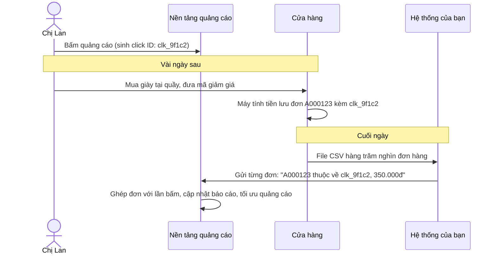

Đây là nghiệp vụ có thật và phổ biến trong ngành quảng cáo số. Cùng một khuôn mẫu "nhận file lớn rồi gửi từng dòng sang hệ thống khác" còn xuất hiện ở ngân hàng (file chi lương), thương mại điện tử (file cập nhật giá, tồn kho), logistics (file tạo đơn vận chuyển hàng loạt).

### Yêu cầu từ phía kinh doanh

Trước khi nghĩ tới code, hãy nghe yêu cầu bằng ngôn ngữ của người kinh doanh:

1. **Mỗi đêm có một file**, vài trăm nghìn dòng. Mùa sale có thể gấp 10 lần.
2. **Không được thiếu đơn.** Thiếu một đơn là báo cáo hiệu quả quảng cáo thấp hơn thực tế.
3. **Không được gửi trùng.** Gửi trùng thì doanh thu báo cáo bị thổi phồng, và nhà quảng cáo có thể ra quyết định sai dựa trên số ảo.
4. **Dòng nào hỏng phải biết lý do**, để cửa hàng sửa dữ liệu.
5. **Nền tảng quảng cáo giới hạn tốc độ**, ví dụ tối đa 200 lần gọi mỗi giây. Gọi nhanh hơn sẽ bị từ chối.
6. **Phải xong trước giờ làm việc sáng hôm sau**, vì đội marketing đọc báo cáo lúc 9 giờ.

Ghi nhớ yêu cầu số 2 và số 3. Gần như mọi quyết định thiết kế phía sau đều để bảo vệ hai câu này: **không thiếu, không trùng**.

---

## Phần 2. Dữ liệu đi qua những đâu

Bỏ qua mọi chi tiết kỹ thuật, luồng dữ liệu chỉ có ba bước:

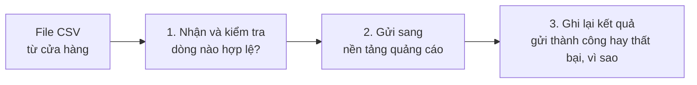

Hình dạng của một đơn hàng thay đổi qua từng bước:

| Bước | Đơn hàng trông như thế nào |
| --- | --- |
| Trong file | Một dòng chữ: `A000123,clk_9f1c2,17,350000,2026-11-13T19:20:00+07:00` |
| Sau khi kiểm tra | Một bản ghi có cấu trúc: mã đơn, click ID, chiến dịch số 17, số tiền 350.000, thời gian |
| Gửi đi | Một request HTTP sang nền tảng quảng cáo |
| Kết quả | Nền tảng trả mã conversion `cv_A000123`, hoặc từ chối kèm lý do |

Nhìn qua thì đơn giản. Vậy hãy viết phiên bản đơn giản nhất.

---

## Phần 3. Phiên bản đầu tiên: cách ai cũng nghĩ ra

Một chương trình, làm tuần tự từ trên xuống:

```go
data := readWholeFile("orders.csv")      // đọc cả file vào bộ nhớ
for _, line := range splitLines(data) {
	order, err := parse(line)
	if err != nil {
		continue                          // dòng hỏng thì bỏ qua
	}
	ref, err := callAdPlatform(order)     // gọi API nền tảng quảng cáo
	if err != nil {
		log.Println("send failed:", err)
		continue
	}
	saveResult(db, order, ref)            // ghi kết quả vào database
}
```

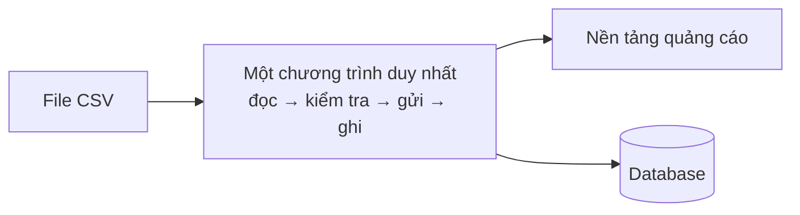

Chạy thử trên máy với file 100 dòng: xong trong 10 giây, kết quả đúng. Mọi thứ có vẻ ổn.

Rồi chương trình được đưa lên production.

---

## Phần 4. Mười một sự cố, mười một bài học

Mỗi sự cố dưới đây được kể theo cùng một khuôn: **chuyện gì xảy ra**, **vì sao**, **cách sửa**, và **bài demo đặt cách sửa đó ở đâu**.

### Sự cố 1. Chương trình chết vì hết bộ nhớ

**Chuyện gì xảy ra.** Mùa sale, cửa hàng gửi file 3 GB. Chương trình chạy vài giây rồi biến mất, không để lại dòng log lỗi nào.

**Vì sao.** Dòng đầu tiên `readWholeFile` đọc cả 3 GB vào RAM, chưa kể bộ nhớ để tách dòng và tạo các bản ghi. Máy chủ chỉ cấp cho chương trình 1 GB. Hệ điều hành tiêu diệt chương trình ngay lập tức, gọi là **OOM kill** (out of memory). Vì bị giết đột ngột, chương trình không kịp ghi log gì.

**Cách sửa: đọc từng dòng (streaming).** Đọc một dòng, xử lý xong, rồi mới đọc dòng tiếp theo. Bộ nhớ dùng gần như cố định, dù file 3 MB hay 30 GB.

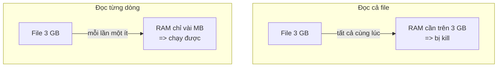

**Trong demo:** importer đọc bằng `csv.Reader` (IMP-3).

> **Ghi nhớ:** Đừng bao giờ giả định dữ liệu đầu vào nhỏ. Hôm nay 10 MB, tháng sau có thể 10 GB.

### Sự cố 2. Đơn hàng biến mất không ai biết

**Chuyện gì xảy ra.** Cửa hàng gọi điện: "Hôm qua có 1.200 đơn, sao báo cáo chỉ có 1.150?". Bạn mở log ra và không tìm thấy gì.

**Vì sao.** Trong phiên bản đầu tiên, dòng nào parse lỗi thì `continue`, tức là lặng lẽ bỏ qua. 50 dòng thiếu click ID hay sai định dạng số tiền đã biến mất mà không để lại dấu vết.

**Cách sửa: dòng hỏng cũng được lưu, kèm lý do.** Mọi dòng đều được ghi vào database. Dòng hợp lệ có trạng thái "chờ gửi". Dòng hỏng có trạng thái `INVALID` và ghi rõ lý do như `missing click_id`, kèm nguyên văn dòng gốc. Cuối ngày, báo cáo cho thấy chính xác dòng nào hỏng, vì sao, để cửa hàng tự sửa.

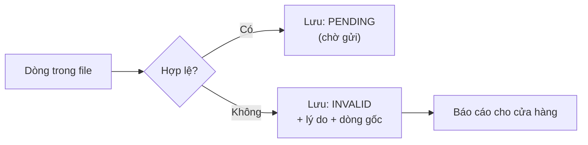

**Trong demo:** IMP-5, AC-10.

> **Ghi nhớ:** Trong backend, "bỏ qua" mà không ghi lại tức là làm mất dữ liệu. Thứ gì không lưu lại thì coi như chưa từng tồn tại.

### Sự cố 3. Chạy 9 tiếng vẫn chưa xong

**Chuyện gì xảy ra.** File 300.000 dòng bắt đầu chạy lúc nửa đêm. 9 giờ sáng đội marketing mở báo cáo, chương trình vẫn đang chạy.

**Vì sao.** Mỗi dòng phải chờ API trả lời khoảng 100 mili giây, cộng thêm thời gian ghi database. Làm tuần tự từng dòng thì:

```
300.000 dòng × khoảng 0,105 giây = khoảng 31.500 giây ≈ gần 9 tiếng
```

Trong gần 9 tiếng đó, phần lớn thời gian CPU chỉ ngồi **chờ mạng**, không làm gì cả.

**Cách sửa: làm nhiều việc cùng lúc, nhưng có giới hạn.**

- **Gửi song song.** Thay vì gửi từng đơn rồi chờ, cho nhiều đơn cùng "đang trên đường". Go làm việc này rất nhẹ nhàng bằng goroutine.
- **Ghi database theo lô.** Thay vì 300.000 câu lệnh `INSERT`, gom 500 dòng thành một câu. Số lần đi về giữa chương trình và database giảm từ 300.000 xuống còn 600.

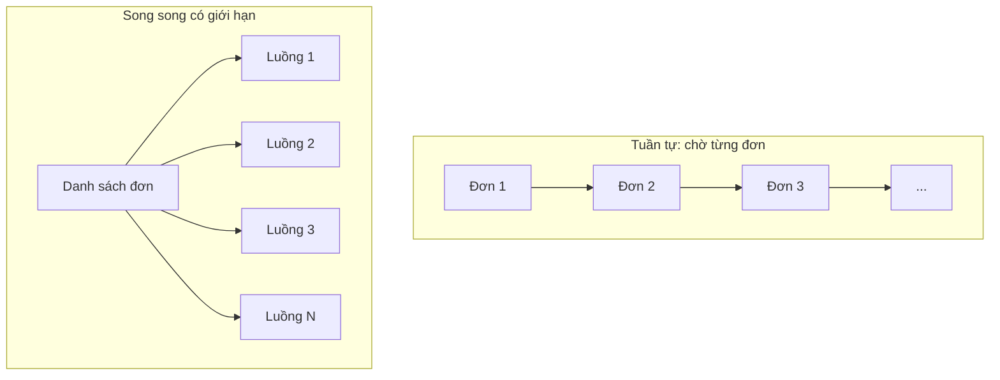

**Nhưng phải có giới hạn.** Nếu tạo một goroutine cho mỗi đơn hàng, 300.000 goroutine sẽ cùng lao vào database và API, làm cả hai quá tải. Song song không giới hạn không phải tối ưu, mà là một kiểu lỗi.

Và còn một giới hạn cứng: nền tảng chỉ nhận 200 lần gọi mỗi giây. Vậy nhanh nhất có thể là `300.000 ÷ 200 = 1.500 giây`, tức khoảng **25 phút**. Từ 9 tiếng xuống 25 phút là đủ để kịp giờ làm việc.

**Trong demo:** pipeline goroutine trong importer (IMP-4), ghi theo lô (IMP-6), giới hạn số message xử lý cùng lúc của worker (WRK-10).

> **Ghi nhớ:** Phần lớn thời gian của backend là **chờ** (chờ mạng, chờ đĩa, chờ database). Song song giúp tận dụng thời gian chờ. Giới hạn giúp không đè chết hệ thống khác.

### Sự cố 4. Chạy lại sau sự cố, khách hàng nhận gấp đôi đơn hàng

**Chuyện gì xảy ra.** Đang gửi tới dòng 150.000 thì đội vận hành deploy bản mới, chương trình bị dừng. Một người chạy lại từ đầu cho chắc. Sáng hôm sau, báo cáo doanh thu của cửa hàng cao gấp đôi thực tế cho 150.000 đơn đầu.

**Vì sao.** Phiên bản đầu tiên **không nhớ mình đã làm tới đâu**. Chạy lại tức là gửi lại tất cả, kể cả 150.000 đơn đã gửi thành công.

Trong production, chương trình bị dừng giữa chừng là chuyện **chắc chắn sẽ xảy ra**: deploy, máy chủ khởi động lại, mất mạng, hết bộ nhớ. Câu hỏi không phải "liệu có xảy ra không", mà là "khi xảy ra thì sao".

**Cách sửa: tách làm hai bước và ghi nhớ trạng thái từng dòng.**

1. **Bước nhận:** đọc file, ghi **tất cả** các dòng vào database trước. Mỗi dòng có một trạng thái.
2. **Bước gửi:** chỉ lấy những dòng chưa xong để gửi. Gửi thành công thì đổi trạng thái thành `DONE`.

Chạy lại bao nhiêu lần cũng chỉ làm tiếp phần còn dở.

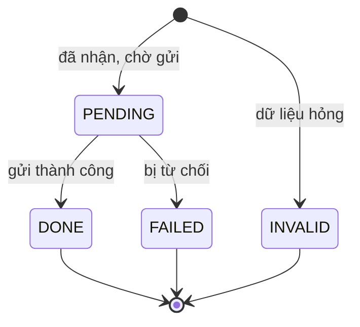

Cần thêm hai "khoá chống trùng" trong database:

- **Mỗi file chỉ thành một lần nhập.** File được nhận diện bằng **dấu vân tay nội dung** (mã SHA-256), không phải bằng tên. Hai file khác nhau tình cờ cùng tên `orders.csv` không bị nhầm; cùng một file nhập hai lần thì lần sau bị bỏ qua.
- **Mỗi dòng của một file chỉ được lưu một lần**, nhờ khoá duy nhất "mã lần nhập + số dòng". Bước nhận bị dừng giữa chừng thì chạy lại từ đầu file; những dòng đã lưu sẽ được database tự bỏ qua.

**Trong demo:** bảng `import_rows` với trạng thái từng dòng, khoá `(job_id, line_no)`, `file_sha256` (IMP-1, IMP-2, IMP-6), AC-3, AC-4.

> **Ghi nhớ:** Mọi bước trong backend phải trả lời được câu: **"Nếu chạy lại lần nữa thì sao?"**. Câu trả lời đúng phải là "không sao cả".

### Sự cố 5. Đơn hàng nằm trong database nhưng không bao giờ được gửi

Để bước gửi chạy được trên nhiều máy (sự cố 6 sẽ nói rõ), nhóm quyết định dùng một **hàng đợi message**. Bước nhận ghi dòng vào database, rồi bỏ một message "có việc mới" vào hàng đợi. Bên gửi lấy message ra và làm.

**Chuyện gì xảy ra.** Một hôm có 500 đơn nằm trong database ở trạng thái `PENDING` mãi mãi, không bao giờ được gửi. Không có lỗi nào trong log.

**Vì sao.** Bước nhận phải làm **hai việc ở hai hệ thống khác nhau**: ghi database, và gửi message vào hàng đợi. Máy chủ bị khởi động lại đúng vào khoảnh khắc giữa hai việc đó.

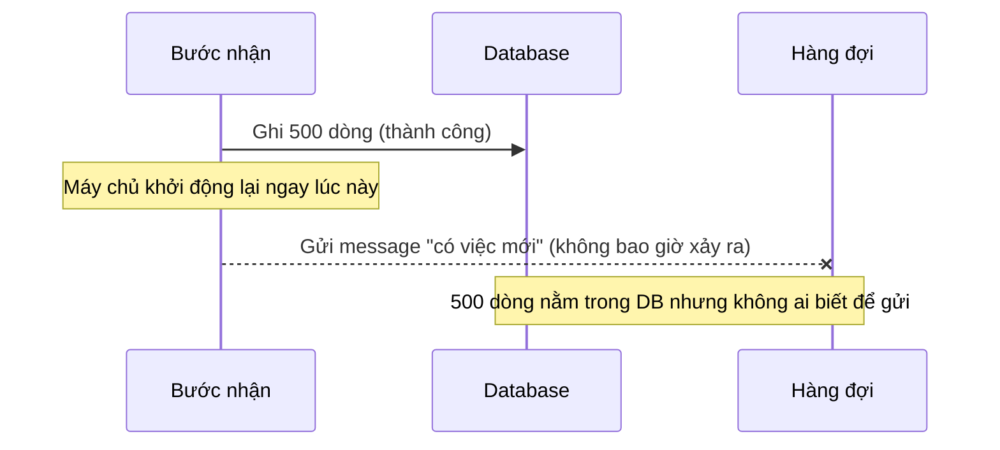

Đổi thứ tự (gửi message trước rồi mới ghi database) cũng không được: lúc đó bên gửi có thể nhận message về một dòng **chưa tồn tại** trong database.

Đây là một vấn đề kinh điển tên là **ghi kép** (dual write). Không có cách nào khiến hai hệ thống khác nhau cùng thành công hoặc cùng thất bại trong một khoảnh khắc.

**Cách sửa: chỉ có một nguồn sự thật, và một người đưa tin riêng.** Bước nhận **chỉ ghi database**. Một chương trình nhỏ riêng, gọi là **relay**, định kỳ hỏi database "có dòng nào `PENDING` chưa được đưa vào hàng đợi không?", rồi đưa chúng vào hàng đợi.

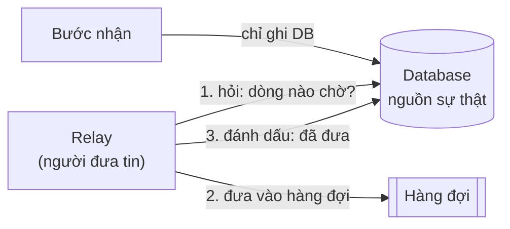

Relay chết ở bất kỳ thời điểm nào thì lần chạy sau nó sẽ hỏi lại database và tiếp tục. Trường hợp xấu nhất: relay đưa một dòng vào hàng đợi, rồi chết trước khi kịp đánh dấu, nên lần sau đưa lại dòng đó. Kết quả là **có thể trùng, nhưng không bao giờ mất**. Chuyện trùng sẽ được giải quyết ở sự cố 7.

Mẫu thiết kế này có tên **Transactional Outbox**. Nếu bạn từng làm app có chế độ offline, bạn đã gặp nó: thao tác của người dùng được lưu vào database trên máy trước, rồi một tiến trình nền gửi lên server khi có mạng.

**Trong demo:** chương trình `relay` (REL-1 đến REL-3).

> **Ghi nhớ:** Khi một bước phải ghi vào hai nơi, hãy chọn **một nơi làm nguồn sự thật**, và để nơi còn lại được cập nhật từ nguồn đó.

### Sự cố 6. Thêm máy cho nhanh, lại gửi trùng

**Chuyện gì xảy ra.** Để nhanh hơn, nhóm chạy hai bản relay trên hai máy. Báo cáo lập tức có đơn hàng bị gửi hai lần.

**Vì sao.** Cả hai relay cùng hỏi database "dòng nào đang chờ?" vào cùng một lúc. Cả hai nhận về **cùng một danh sách** 500 dòng, và cùng đưa chúng vào hàng đợi.

**Cách sửa, gồm hai phần:**

**Phần 1, cho relay: "lấy phần của mình, bỏ qua phần người khác đang cầm".** MySQL có câu lệnh `SELECT ... FOR UPDATE SKIP LOCKED`. Relay A khoá 500 dòng nó lấy. Relay B khi hỏi sẽ **tự động bỏ qua** những dòng đang bị khoá và lấy 500 dòng tiếp theo.

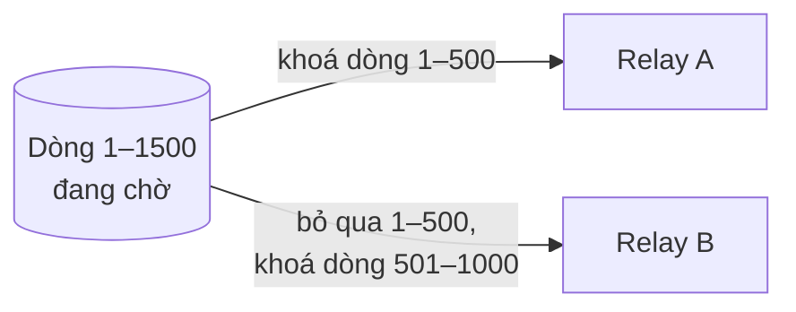

**Phần 2, cho bên gửi: để hàng đợi tự chia việc.** Ở bước gửi, nhiều worker cùng nghe một hàng đợi. Hàng đợi (trong demo là Google Pub/Sub) tự giao mỗi message cho **một** worker. Muốn nhanh hơn thì chỉ cần thêm worker, không phải sửa code.

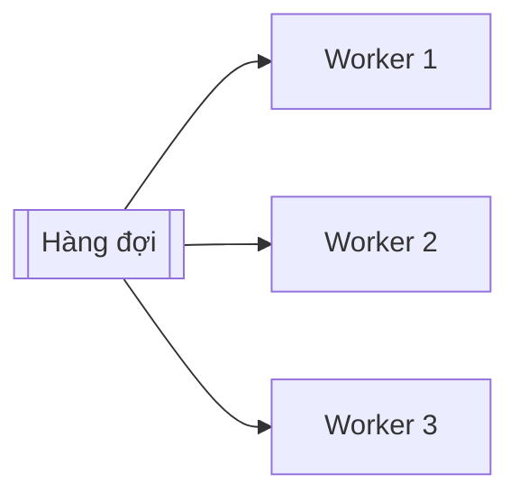

Hàng đợi còn một lợi ích nữa: nó là **vùng đệm**. Bước nhận có thể ghi 10.000 dòng mỗi giây, trong khi nền tảng quảng cáo chỉ nhận 200 dòng mỗi giây. Phần chênh lệch nằm chờ trong hàng đợi, không ai phải đứng đợi ai.

**Trong demo:** `SKIP LOCKED` trong relay (REL-1, REL-4), nhiều worker cùng nghe một subscription Pub/Sub (`docker compose up --scale worker=3`).

> **Ghi nhớ:** Khi nhiều máy cùng làm một việc, luôn hỏi: **"Hai máy có thể cùng nhận một phần việc không?"**. Nếu có, cần một cơ chế để chia việc.

### Sự cố 7. Hàng đợi tự giao một message hai lần

**Chuyện gì xảy ra.** Đã làm hết những điều trên, thỉnh thoảng vẫn có đơn bị gửi trùng.

**Vì sao.** Đây không phải lỗi của bạn, mà là **cam kết** của hàng đợi. Pub/Sub đảm bảo mỗi message được giao **ít nhất một lần** (at-least-once). Nghĩa là có thể giao hai lần. Ví dụ:

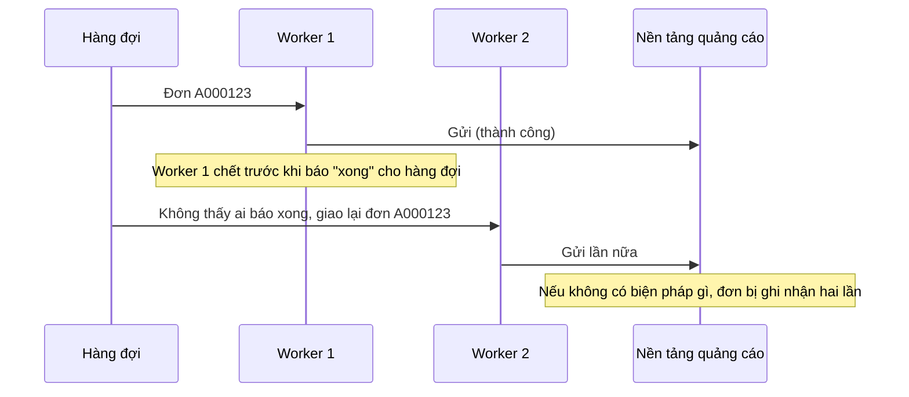

Hàng đợi chỉ biết một việc đã xong khi worker **báo lại** (gọi là **ack**). Worker xử lý xong nhưng chết trước khi kịp báo thì hàng đợi không thể biết, nên an toàn nhất là giao lại.

**Cách sửa: làm cho việc gửi trở nên "idempotent".** Idempotent nghĩa là làm một việc nhiều lần thì kết quả vẫn như làm một lần. Đây là yêu cầu bắt buộc khi làm việc với hàng đợi. Bài demo dùng **ba lớp bảo vệ**, lớp sau chặn những gì lớp trước bỏ lọt:

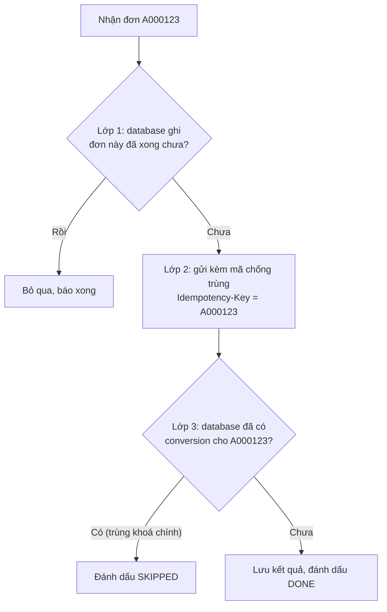

1. **Kiểm tra trước khi làm.** Nhanh, chặn phần lớn trường hợp. Nhưng có khe hở: hai worker cùng kiểm tra đúng một lúc thì cả hai đều thấy "chưa xong".
2. **Mã chống trùng gửi sang đối tác** (Idempotency-Key). Nền tảng quảng cáo thấy cùng một mã thì chỉ ghi nhận một lần. Các API thanh toán dùng đúng cơ chế này để không trừ tiền hai lần khi người dùng bấm nút "Thanh toán" hai lần.
3. **Khoá chính trong database.** Bảng kết quả dùng mã đơn hàng làm khoá chính, nên database từ chối lưu cùng một đơn lần thứ hai. Đây là chốt chặn cuối cùng, không có khe hở.

**Trong demo:** WRK-1, WRK-6, WRK-7, bảng `conversions` với khoá chính `order_id`, AC-5.

> **Ghi nhớ:** Khi dùng hàng đợi, đừng hỏi "làm sao để không bao giờ nhận trùng" (không làm được). Hãy hỏi "**nhận trùng thì xử lý thế nào để kết quả vẫn đúng**".

### Sự cố 8. Thêm worker lại chậm hơn

**Chuyện gì xảy ra.** Đang có 1 worker, nhóm tăng lên 3 để nhanh gấp 3. Kết quả lại chậm hơn trước, log đầy lỗi `429 Too Many Requests`.

**Vì sao.** Mỗi worker tự giới hạn mình ở 200 lần gọi mỗi giây. Nhưng giới hạn của nền tảng quảng cáo tính cho **cả hệ thống của bạn**, không phải cho từng worker. 3 worker cộng lại là 600 lần mỗi giây, gấp ba mức cho phép. Nền tảng từ chối phần lớn request, các worker phải thử lại liên tục, nên tổng thể chậm hơn. Một số nền tảng còn tạm khoá tài khoản khi bị vượt giới hạn liên tục.

**Cách sửa: một "quầy phát vé" dùng chung.** Trước mỗi lần gọi API, worker phải xin một "vé" từ một nơi chung, ở đây là **Redis**. Quầy chỉ phát đúng 200 vé mỗi giây cho tất cả mọi người. Hết vé thì phải đợi giây tiếp theo.

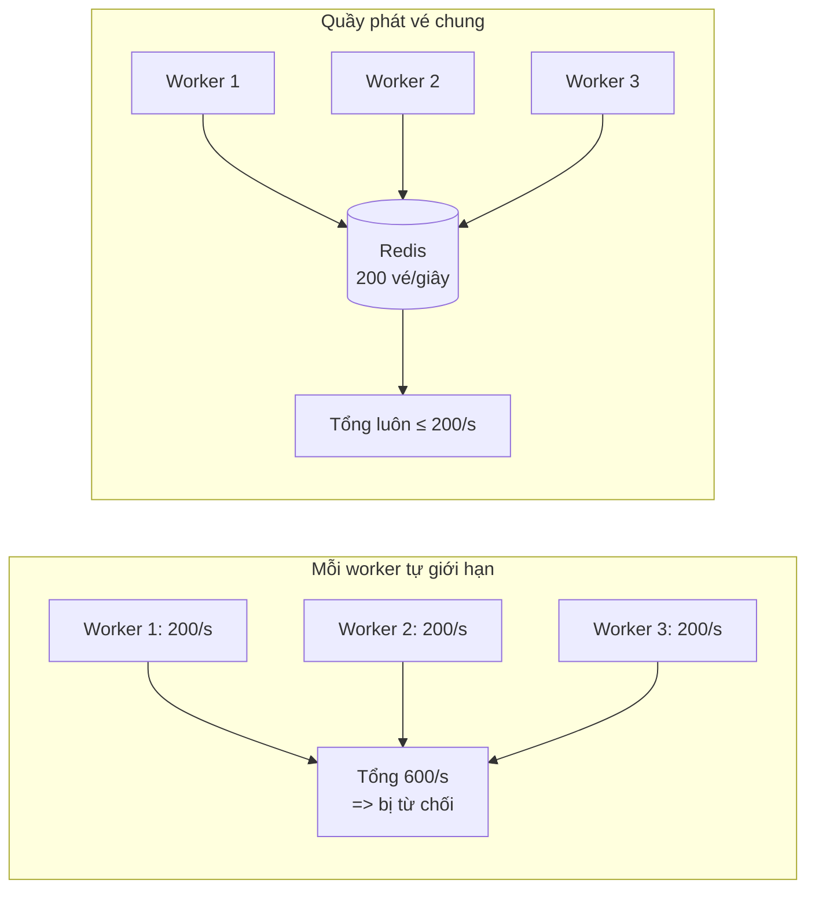

Vì sao phải là Redis mà không phải biến trong chương trình? Vì 3 worker là 3 chương trình riêng, có thể chạy trên 3 máy khác nhau. Chúng không nhìn thấy bộ nhớ của nhau, nên cần một nơi chung mà tất cả cùng hỏi được.

**Trong demo:** rate limiter dùng chung trên Redis (WRK-4); bộ đếm số lần gọi mỗi giây để chứng minh nó hoạt động (WRK-5, AC-6, AC-7).

> **Ghi nhớ:** Khi scale ra nhiều máy, mọi **giới hạn dùng chung** (tốc độ gọi API, số kết nối database) phải được tính cho cả hệ thống, không phải cho từng máy.

### Sự cố 9. Thử lại mãi một đơn hàng không bao giờ thành công

**Chuyện gì xảy ra.** Sau khi thêm cơ chế "lỗi thì thử lại", một số worker cứ quay vòng mãi với cùng vài trăm đơn. Hàng đợi tắc nghẽn, các đơn khác phải chờ.

**Vì sao.** Không phải lỗi nào cũng nên thử lại:

- Nền tảng trả "click ID đã hết hạn" (lỗi `400`). Thử lại một nghìn lần thì vẫn hết hạn.
- Nền tảng trả "đang quá tải" (`429`) hoặc "lỗi máy chủ" (`500`), hoặc mạng chập chờn. Đợi một lúc thử lại thì thường thành công.

Thử lại cả loại thứ nhất là lãng phí vô tận. Không thử lại loại thứ hai thì mất đơn chỉ vì một lần chập mạng 2 giây.

**Cách sửa: phân loại lỗi, chờ tăng dần, và giới hạn số lần thử.**

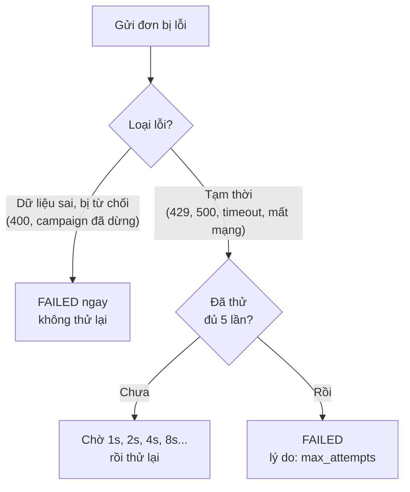

- **Chờ tăng dần** (backoff): 1 giây, 2 giây, 4 giây, 8 giây. Nếu thử lại ngay lập tức, nền tảng đang quá tải sẽ càng bị dội thêm request và càng khó hồi phục.
- **Giới hạn số lần thử:** quá 5 lần thì dừng, đánh dấu thất bại kèm lý do. Một message lỗi mãi mãi mà không giới hạn được gọi là **poison message**, nó có thể làm tắc cả hàng đợi.

**Trong demo:** WRK-8, WRK-9; dòng có click ID bắt đầu bằng `clk_old` (bị từ chối) và `clk_err` (lỗi máy chủ mãi mãi) trong file mẫu để kiểm chứng (AC-9).

> **Ghi nhớ:** Trước khi viết "lỗi thì thử lại", hãy hỏi: **"Lỗi này có tự hết không?"**. Không tự hết thì đừng thử lại.

### Sự cố 10. Database bị hỏi cùng một câu 300.000 lần

**Chuyện gì xảy ra.** Đêm import, các màn hình khác dùng chung database bỗng chậm hẳn.

**Vì sao.** Trước khi gửi mỗi đơn, worker phải kiểm tra "chiến dịch quảng cáo của đơn này còn chạy không?". 300.000 đơn là 300.000 lần hỏi database. Nhưng 300.000 đơn đó chỉ thuộc khoảng **200 chiến dịch**. Database bị hỏi đi hỏi lại cùng một câu và trả lời cùng một kết quả.

**Cách sửa: ghi nhớ câu trả lời (cache).** Lần đầu hỏi về chiến dịch số 17, worker hỏi database rồi **lưu câu trả lời vào Redis** trong 10 phút. Những lần sau, worker hỏi Redis trước. Redis nằm trong RAM nên trả lời nhanh hơn database rất nhiều.

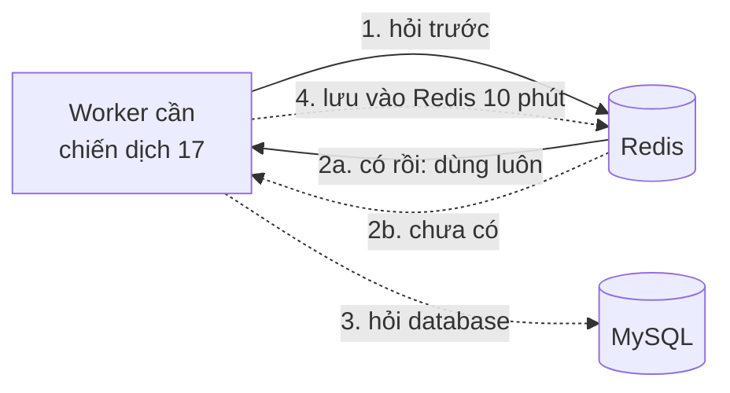

Kết quả: thay vì 300.000 lần, database chỉ bị hỏi khoảng 200 lần.

Vài chi tiết làm cache "tốt":

- **Cache cả câu trả lời "không tồn tại".** Chiến dịch số 215 không có trong database. Nếu không nhớ điều đó, mọi đơn thuộc chiến dịch 215 vẫn hỏi thẳng database.
- **Redis hỏng thì hỏi thẳng database.** Cache để chạy nhanh hơn, không phải để chạy đúng. Redis chết thì hệ thống chậm đi, nhưng không được dừng lại.
- **Vì sao không lưu trong bộ nhớ từng worker?** Khi một chiến dịch bị tạm dừng, chỉ cần xoá một chỗ trong Redis là cả 3 worker cùng biết. Lưu riêng từng worker thì phải đợi từng worker tự hết hạn.

**Trong demo:** cache-aside trên Redis (WRK-2), số lần cache hit và miss trong báo cáo (AC-8).

> **Ghi nhớ:** Khi thấy cùng một câu hỏi được lặp lại rất nhiều lần với cùng câu trả lời, đó là dấu hiệu nên dùng cache.

### Sự cố 11. Mỗi lần deploy là một lần làm dở việc

**Chuyện gì xảy ra.** Mỗi lần deploy bản mới, log có hàng trăm dòng lỗi kiểu "đang ghi dở thì bị ngắt".

**Vì sao.** Khi deploy, nền tảng chạy chương trình (Docker, Cloud Run, Kubernetes) báo cho chương trình cũ bằng một tín hiệu tên là `SIGTERM`, đợi vài giây, rồi tắt hẳn. Phiên bản đầu tiên không nghe tín hiệu này, nên bị cắt ngang khi đang xử lý hàng trăm đơn.

Nhờ những gì đã làm ở sự cố 4 và 7, dữ liệu không bị hỏng. Nhưng những đơn đó phải làm lại từ đầu, và nếu nền tảng quảng cáo đã nhận đơn mà database chưa kịp ghi thì phải trông vào lớp bảo vệ 2 và 3.

**Cách sửa: tắt có trật tự (graceful shutdown).** Khi nhận `SIGTERM`: ngừng nhận việc mới, làm nốt việc đang dở, báo "xong" cho hàng đợi, rồi mới thoát.

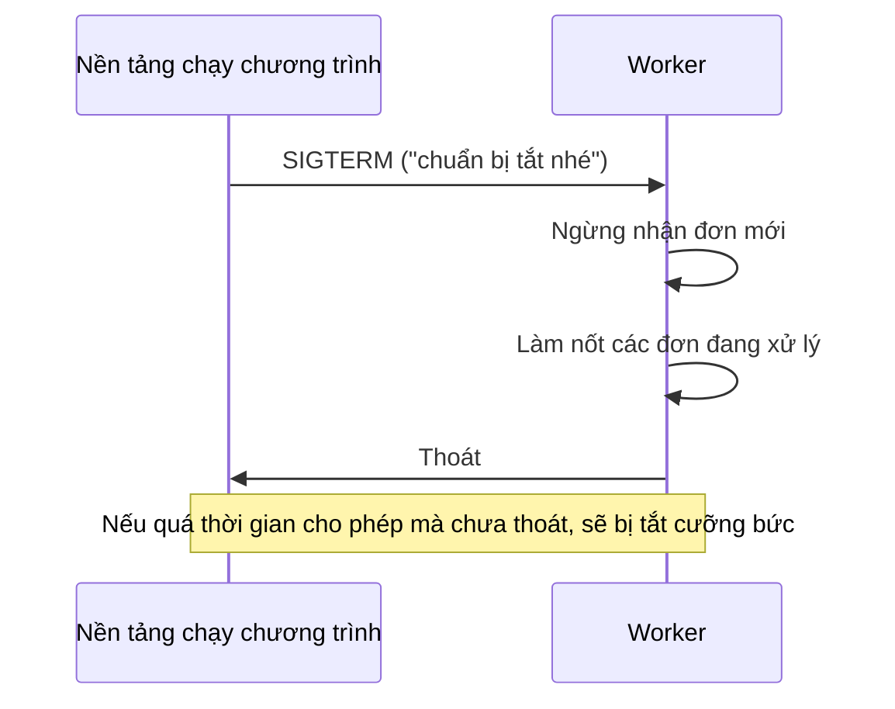

Với lập trình mobile, việc này giống như lưu trạng thái khi app sắp bị hệ điều hành đóng. Khác biệt là backend nhận tín hiệu này **mỗi lần deploy**, có thể nhiều lần mỗi ngày.

**Trong demo:** IMP-8, REL-7, WRK-12.

> **Ghi nhớ:** Trong backend, chương trình bị tắt là chuyện thường ngày. Hãy viết để nó **tắt đẹp**.

---

## Phần 5. Bức tranh cuối cùng

Ghép tất cả các cách sửa lại, ta có đúng kiến trúc của bài demo. Mỗi thành phần đều có lý do tồn tại, ghi bằng số sự cố mà nó giải quyết:

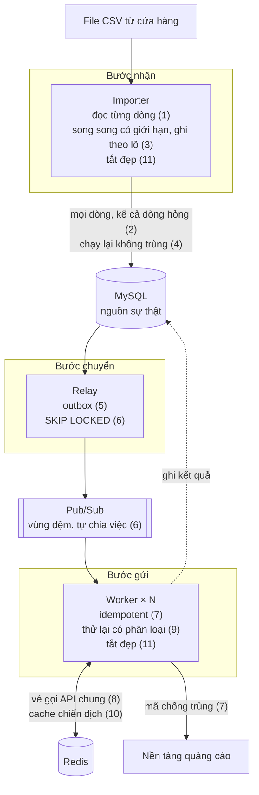

Hãy so sánh với sơ đồ ở Phần 3. Từ **một** chương trình, hệ thống tách thành **ba** bước được ngăn cách bằng nơi lưu trữ bền vững (database, hàng đợi). Nhờ vậy:

- Bước nào chết cũng không kéo theo bước khác.
- Bước nào chậm thì chỉ cần tăng thêm bản cho riêng bước đó.
- Chạy lại bước nào cũng an toàn.

---

## Phần 6. Hành trình của đơn hàng A000123

Theo chân một đơn hàng qua hệ thống hoàn chỉnh, kể cả lúc nó bị giao trùng:

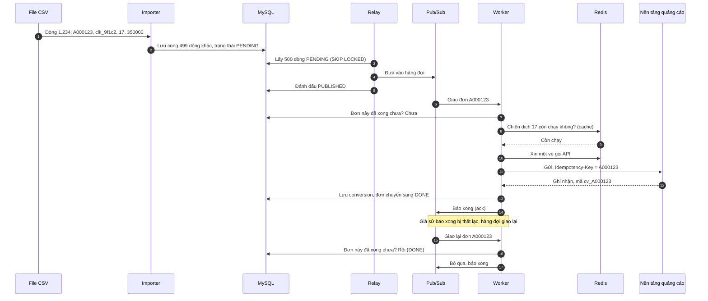

Đơn hàng được giao hai lần, nhưng chỉ được ghi nhận **một** lần. Đó chính là "không thiếu, không trùng".

---

## Phần 7. Bảng tổng kết

| # | Vấn đề production | Giải pháp | Trong demo | Câu hỏi phỏng vấn có thể gặp |
| --- | --- | --- | --- | --- |
| 1 | File lớn làm hết bộ nhớ | Đọc từng dòng (streaming) | IMP-3 | "File 50 GB thì bạn xử lý thế nào?" |
| 2 | Dòng hỏng biến mất không dấu vết | Lưu `INVALID` kèm lý do | IMP-5 | "Dữ liệu đầu vào xấu thì sao?" |
| 3 | Làm tuần tự quá chậm | Song song có giới hạn, ghi theo lô | IMP-4, IMP-6, WRK-10 | "Tạo 1 triệu goroutine được không?" |
| 4 | Chạy lại thì gửi trùng | Lưu trạng thái từng dòng, khoá duy nhất | IMP-1, IMP-2, IMP-6 | "Job chết giữa chừng thì chạy lại thế nào?" |
| 5 | Ghi vào hai hệ thống, mất dữ liệu ở giữa | Transactional Outbox với relay | REL-1 → REL-3 | "Dual write là gì, xử lý ra sao?" |
| 6 | Nhiều máy cùng lấy một việc | `SKIP LOCKED`, hàng đợi tự chia việc | REL-1, REL-4 | "Scale ngang thì tránh xử lý trùng thế nào?" |
| 7 | Hàng đợi giao một message hai lần | Idempotent ba lớp | WRK-1, WRK-6, WRK-7 | "At-least-once là gì? Idempotent là gì?" |
| 8 | Nhiều worker vượt giới hạn API | Rate limiter dùng chung trên Redis | WRK-4, WRK-5 | "Rate limit cho nhiều instance làm thế nào?" |
| 9 | Thử lại sai loại lỗi | Phân loại lỗi, backoff, giới hạn số lần thử | WRK-8, WRK-9 | "Lỗi nào nên retry, lỗi nào không?" |
| 10 | Database bị hỏi lặp lại | Cache-aside trên Redis | WRK-2 | "Khi nào dùng cache? Cache sai thì sao?" |
| 11 | Deploy làm cắt ngang việc đang làm | Graceful shutdown khi nhận `SIGTERM` | IMP-8, REL-7, WRK-12 | "Service của bạn xử lý SIGTERM thế nào?" |

Nếu trả lời được cột cuối bằng chính ví dụ trong bài demo, bạn đã nắm được phần cốt lõi của backend xử lý dữ liệu.

---

## Phần 8. Những vấn đề production mà demo chưa giải

Bài demo cố ý nhỏ. Một hệ thống thật còn phải lo thêm:

- **Theo dõi và cảnh báo.** Ai báo cho bạn biết lúc 3 giờ sáng hàng đợi đang tồn 2 triệu message? Hệ thống thật có biểu đồ và cảnh báo tự động.
- **File đến từ cloud.** File thật nằm trên Google Cloud Storage, và việc có file mới tự động sinh ra một message báo cho importer.
- **Dữ liệu cá nhân.** Email và số điện thoại khách hàng phải được mã hoá một chiều trước khi gửi đi, và chỉ những người có quyền mới xem được dữ liệu gốc.
- **Đối soát.** Cuối tháng, so số đơn bạn đã gửi với số đơn nền tảng đã ghi nhận. Chênh lệch nghĩa là có lỗi ở đâu đó.
- **Dòng kẹt lâu.** Một tiến trình quét định kỳ đưa những dòng kẹt ở `PUBLISHED` quá lâu về lại `PENDING` để gửi lại. Điều này an toàn nhờ idempotent.

Khi phỏng vấn, nói được "demo của em chưa làm phần này, nhưng em biết production cần nó vì..." là một điểm cộng.

---

## Phần 9. Đọc gì tiếp theo

| Muốn biết | Đọc |
| --- | --- |
| Bắt đầu làm thế nào, giai đoạn nào trước | `docs/00-getting-started.md` |
| Chính xác hệ thống phải làm gì, tiêu chí nghiệm thu | `docs/01-requirement-conversion-pipeline.md` |
| Chi tiết kỹ thuật của từng giải pháp, so sánh với mobile | `docs/02-architecture-conversion-pipeline.md` |
| Viết code theo quy ước nào | `docs/03-coding-guidelines.md` |

Mỗi khi viết một phần code, hãy quay lại tài liệu này và tự hỏi: **"Đoạn code mình đang viết giải quyết sự cố số mấy?"**. Nếu không trả lời được, có thể đoạn code đó là dư thừa.
